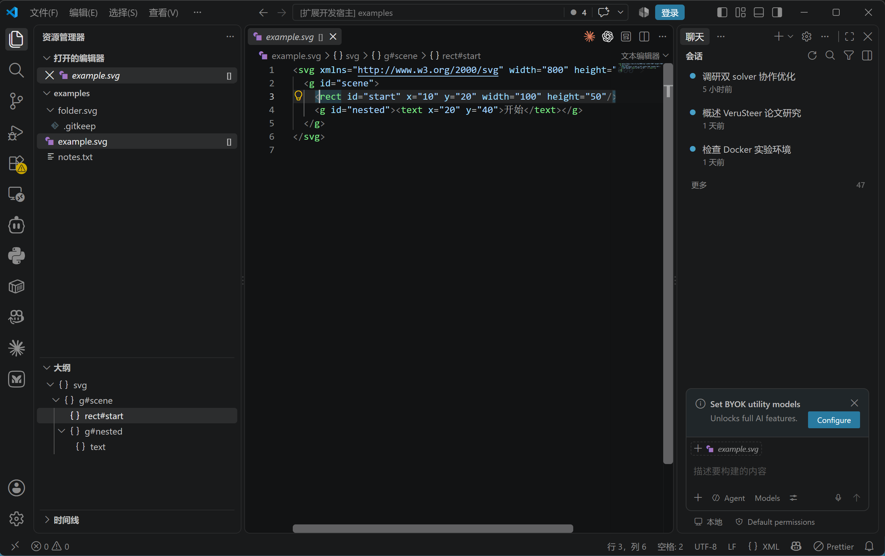
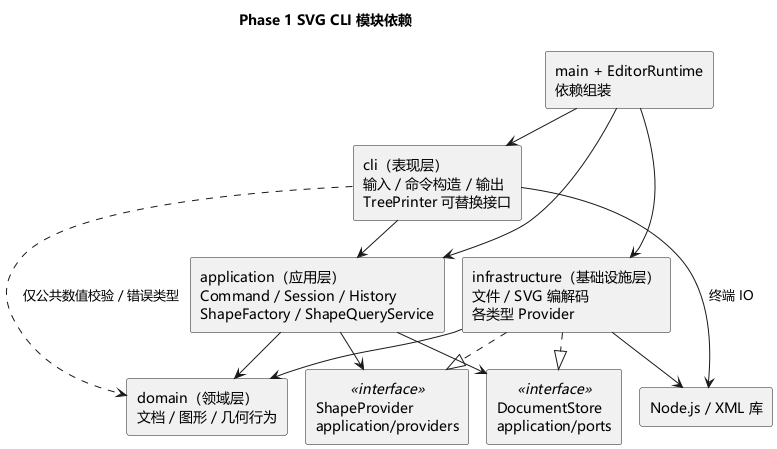
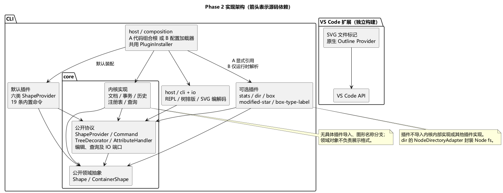

# PJ1 Phase 2：插件实践与插件式重构报告

仓库：[2026software-design-pj_hxy](https://github.com/xinyue-huang0710/2026software-design-pj_hxy)。沿用 TypeScript、面向对象、一类一文件和分步 Git 提交。Phase 1 的 final 保留；本阶段收尾标签为 p2，只有交付文件与验证齐备后创建，不移动既有标签。

依据：[Phase 2 要求](../pj1-phase2/phase_cli_2.md)、[Phase 1 要求](../phase_cli_1.md)。原报告归档为 [phase1-README.md](phase1-README.md)，本报告描述当前实现。Phase 2 截止日期及 eLearning 上传规则未在要求中给出。

## 1. 安装、运行与验收入口

需要 Node.js >=22，实际验证环境为 Node.js 24.14.0、Windows、VS Code 1.135.0。在仓库根执行：

~~~sh
npm ci
npm run build
npm run cli
npm run cli -- --config plugins.config.json
npm run cli -- --builtin-only
~~~

三种 CLI 启动依次为 A 代码装配、B 配置装配、仅 Phase 1 默认能力。A/B 默认包含 stats、dir、box 及两个树标签。先 build 可保证相对路径插件具有编译入口；源码开发使用 development 条件，编译程序使用各包 dist。Windows PowerShell 若拦截 npm.ps1，改用 npm.cmd。CLI 输入 help 查看命令，Ctrl+C 退出。

~~~text
dir
init
create box n1 120 100 160 60 "开始"
set n1 fill #f5a623
set n1 label "处理数据"
tree
stats
undo
redo
save examples/my-box.svg
~~~

单独禁用某个可选插件：在 plugins.config.json 的对应项设置 enabled:false，使用 B 启动。A 可在 [codePlugins.ts](../packages/host/src/composition/codePlugins.ts) 移除相应安装项并重新构建。内置六种图形和 19 条命令由宿主默认装配，不依赖可选插件成功加载。

~~~sh
npm run check
npm run extension:test
node tools/replay-phase2.mjs
node tools/verify-plugin-diffs.mjs
~~~

check 包含严格类型检查、构建、CLI 测试和大纲解析测试；extension:test 使用真正的 VS Code 扩展宿主。验证输出见 [phase2-check.txt](validation/phase2-check.txt)，人工证据见 [vscode-manual.md](validation/vscode-manual.md)。

## 2. VS Code 扩展：效果、模式和复用

源码与启动说明位于 [extensions/svg-tools](../extensions/svg-tools/README.md)，样例为 [example.svg](../extensions/svg-tools/examples/example.svg)。

仓库根执行 npm ci 后，在 VS Code 选择调试配置 PJ1 SVG Tools，通过“运行 → 启动调试”打开独立扩展开发宿主；F5 若是音量键则用 Fn+F5。构建任务已包含在调试配置中。无需发布到市场或安装到日常配置。

SVG 可能默认打开为图片预览：右键标签页 → 重新打开编辑器的方式 → 文本编辑器。展开资源管理器左下角的“大纲”。节点 rect#start 应定位第 3 行；临时改 id 会更新大纲。notes.txt 和名为 folder.svg 的目录不显示 []。

人工验证：用户提供真实截图，确认文件标记、嵌套大纲、点击定位和 start → test → start 的实时更新。图片已归档并核对，以下同时展示 A.1 文件标记和 A.2 定位。

不完整 XML 暂时返回空树，修复后恢复，由 [Extension Host 自动结果](validation/vscode-integration.json) 与解析测试验证。没有将该异常路径声称为用户人工操作。开发前先以无功能扩展观察原生行为，保存 [空符号基线](validation/vscode-baseline.json)。

| 实体 | 职责与调用关系 |
|---|---|
| VS Code | 管理 Explorer、原生大纲、打开的文本、编辑事件和定位；按需要调用注册的 provider |
| extension.activate | 用 window.registerFileDecorationProvider、languages.registerDocumentSymbolProvider 注册实例；Disposable 放进 context.subscriptions |
| SvgFileDecorator | 对真实 SVG 文件返回 badge=[]；排除目录、非 SVG、缺失文件和已取消请求；不修改文件名或内容 |
| SvgOutlineParser | 解析 XML 层级与 UTF-16 源位置，包含无 id 元素；不完整输入安全返回空结果 |
| SvgSymbolProvider | 将解析节点转成 DocumentSymbol，提供 children、range、selectionRange |

API 依据：[VS Code API](https://code.visualstudio.com/api/references/vscode-api)、[原生文档符号](https://code.visualstudio.com/api/language-extensions/programmatic-language-features#show-all-symbol-definitions-within-a-document)、[扩展宿主测试](https://code.visualstudio.com/api/working-with-extensions/testing-extension)。

模式分析：FileDecorationProvider 是宿主汇集附加显示信息的机制，具有装饰效果，但没有相同 Component 接口逐层包装，不能仅因名字称为严格 GoF Decorator。SvgSymbolProvider 将解析结果适配为 VS Code 规定的 DocumentSymbol，体现 Adapter 的接口转换；SvgFileDecorator 则把 URI/文件类型判断转成宿主消费的 FileDecoration。宿主管调用时机、插件实现回调，体现控制反转和依赖接口。

复用评估：复用 saxes 库及栈遍历思路，没有直接搬用 CLI 的 SvgReader/Shape。CLI 模型限制图形类型、校验几何、补 id，而且不保留源码位置；大纲必须容纳源文件中更多 XML 元素，并精确映射文本。强行复用领域对象会增加无关约束。扩展有自己的只读语法节点，领域层仍不关心 VS Code 展示格式。

## 3. Phase 1 → Phase 2 架构

重构前：[PlantUML 源码](diagrams/architecture.puml)。

重构后：[PlantUML 源码](diagrams/phase2-architecture.puml)。图中箭头表示依赖；B 的插件连线表示运行时模块解析，并非加载器静态导入。

PNG/SVG 均提交，Markdown 查看不需要 plantuml.jar；重新生成方法见 [图表说明](diagrams/README.md)。

| 层/包 | 实际职责 |
|---|---|
| packages/core | 公开 Shape/ContainerShape、扩展协议、用例端口；内部文档、候选事务、历史、注册表和查询 |
| packages/host | REPL、命令调度、tree/show 格式化、文件与 SVG 编解码、加载器、组合根 |
| plugins/builtin-shapes | 六种内置图形与各自 Provider |
| plugins/builtin-commands | 19 条内置命令、各命令的参数规则与 help |
| plugins/command-stats、command-dir | 两个独立命令插件；dir 包拥有 Node 文件系统适配器 |
| plugins/shape-box | box 类、Provider、两个属性处理器 |
| plugins/tree-box-label、tree-modified | 两个互不导入的树标签插件 |
| extensions/svg-tools | 独立构建的 VS Code 插件，不进入 CLI 内核依赖 |

[源码迁移映射](architecture/source-migration.json) 记录旧路径。插件只能导入 @svgframe/core 的公开抽象与协议；不导入 core/internal、host 或其他插件实现。ShapeCreation 使 box 能请求创建 rect/text 而不导入具体类。内核本身不导入具体插件，也不通过图形名字选择业务算法。[依赖测试](../tests/architecture/dependencies.test.ts) 检查实际 imports 及一类一文件。

保留 Command：Client 为组合根与命令注册工厂，Invoker 为 CommandInvoker，Command 为公开执行接口，ConcreteCommand 为 MoveCommand/StatsCommand/DirCommand 等，Receiver 为 EditorActions 所代表的 EditorSession 或 DirectoryReader。命令处理参数并转发用例；文档修改与事务规则位于接收者，编辑命令共享 EditCommand 快照模板。

保留图形的几何多态与容器组合，不引入经典 Visitor。新增图形通过 ShapeProvider 注册，避免扩充统一 visit 枚举。领域层负责几何与不变量；外部 Provider 映射展示/序列化数据。TreePrinter 替换整棵树的排版，TreeDecorator 追加行尾标签，两种扩展方向独立。

## 4. 扩展点清单：实际接口、调用和契约

接口通过 [core/index.ts](../packages/core/src/index.ts) 导出。下表位置均为当前源码，可逐项定位。

| 扩展点与职责 | 实际调用位置 | 已有类实现 |
|---|---|---|
| [ShapeProvider](../packages/core/src/application/providers/ShapeProvider.ts)：创建、读回、展示视图、序列化、可选命令反馈 | [ShapeFactory](../packages/core/src/application/providers/ShapeFactory.ts) 的 create/fromSvg/inspect/toSvgElement/feedback；由 EditorSession、ShapeQueryService、SVG 编解码使用 | RectProvider、CircleProvider、EllipseProvider、LineProvider、TextProvider、GroupProvider、BoxProvider |
| [Command](../packages/core/src/application/commands/Command.ts) 与 [CommandRegistration](../packages/core/src/contracts/CommandRegistration.ts)：执行接口；名称/语法/help/构造 | [CommandRegistry.create](../packages/core/src/application/CommandRegistry.ts) 按名称选工厂；[CommandInvoker](../packages/core/src/application/CommandInvoker.ts) 调用 execute | 19 个内置命令类；StatsCommand、DirCommand，各自有注册类 |
| [TreeDecorator](../packages/core/src/contracts/TreeDecorator.ts)：只读每行快照并返回尾部标签，可监听文档事件 | [TreeDecorationService.decorate/notify](../packages/core/src/application/TreeDecorationService.ts)；EditorSession.tree/flushEvents 接入树查询与事件 | BoxTypeDecorator、ModifiedStarDecorator |
| [AttributeHandler](../packages/core/src/contracts/AttributeHandler.ts)：决定属性语义及候选文档修改 | [AttributeService.set](../packages/core/src/application/AttributeService.ts)，由 EditorSession.set 调用 | BoxFillHandler、BoxLabelHandler |

注册统一经过 [ExtensionRegistry.install](../packages/core/src/application/ExtensionRegistry.ts)。下面分别说明禁用可选扩展与违规后的行为，避免只列接口名字。

| 扩展点 | 禁用可选实现 | 契约违反/错误 |
|---|---|---|
| ShapeProvider | 六类内置不变；create box 报 unknown shape type；带 data-kind=box 的 g 降级普通分组 | 返回错误 id 报 provider returned wrong id；类型不匹配报 provider/type mismatch；参数/结构错误拒绝候选事务或整个 read |
| Command | stats/dir 从 help 消失；执行报 error: unknown command: stats/dir；内置命令照常 | 注册时检查名称、create 和 help；参数错误由插件报告；执行异常由 CLI 转成 error 行，编辑事务失败不入历史 |
| TreeDecorator | 全禁用时 tree 与 final 输出逐字节一致；单禁用时其他标签仍生效 | 非字符串或换行标签报 invalid tree label；事件回调抛错则停用该实例并给 warning，已提交编辑保留 |
| AttributeHandler | 无命中走 Phase 1 Shape.setAttribute 白名单；普通 rect 不接受 label | 多命中报 attribute handler conflict；handles/apply 抛错整体回滚，不再尝试默认规则 |

所有类别重名均拒绝当前插件，输出 error: duplicate registration: <category>/<name>。清单不匹配、激活失败均不发布当前插件的任何暂存注册。插件是受信任代码；接口隔离不等于防恶意代码沙箱。

## 5. 两种装配、配置和零修改证据

A 组合根为 [codePlugins.ts](../packages/host/src/composition/codePlugins.ts)。B 为 [plugins.config.json](../plugins.config.json)，通过 [PluginLoader](../packages/host/src/loading/PluginLoader.ts) 动态解析。二者都调用 [PluginInstaller.install](../packages/host/src/loading/PluginInstaller.ts) 再进入统一原子注册。

~~~json
{
  "plugins": [
    {"module": "@svgframe/plugin-command-stats"},
    {"module": "./plugins/command-dir"},
    {"module": "@svgframe/plugin-shape-box", "options": {}},
    {"module": "@svgframe/plugin-tree-box-label"},
    {"module": "@svgframe/plugin-tree-modified", "enabled": true}
  ]
}
~~~

数组顺序即加载及同类注册顺序。enabled 默认 true；false 跳过解析。相对路径相对配置文件目录，包名由 Node 解析。options 对象浅复制并冻结传给插件的同步 activate(context, options)；当前插件无需专属配置项。配置语法/结构不合法时整份拒绝，输出 error: invalid plugin config，以默认内置能力启动。

插件 package.json 声明 main/exports 编译入口及 contributes。当前 box 的声明为：

~~~json
{
  "name": "@svgframe/plugin-shape-box",
  "contributes": {
    "shapes": ["box"],
    "attributes": ["box-fill", "box-label"]
  }
}
~~~

其余可用类别为 commands、decorators，缺省为空；实际 register 名称集合必须一致。默认导出为实现 Plugin 的可实例化类。同步 activate 只注册能力，不操作文档，不能在返回后异步补注册。

| 失败 | 输出与后续行为 |
|---|---|
| 顶层模块找不到 | error: plugin not found: <module> |
| 无默认导出 | error: plugin has no default export: <module> |
| 清单不一致 | error: plugin manifest mismatch: <name> (declared: …, registered: …) |
| 激活/模块求值/内部依赖失败 | error: plugin failed to activate: <name> (<reason>) |

每次失败保留已成功插件，继续后续插件，不退出主程序。实现与测试参见 [ADR 004](adr/004-plugin-loading.md)。

两种 box 接入从同一已完成框架、stats、dir 的提交 1118af2 出发：

| 模式 | 远程演示分支/提交 | 运行代码差异 |
|---|---|---|
| A | [phase2/box-code，e00d2ff](https://github.com/xinyue-huang0710/2026software-design-pj_hxy/commit/e00d2ff) | 新增 shape-box 包，仅修改一个既有运行文件 codePlugins.ts |
| B | [phase2/box-config，dbcfd3a](https://github.com/xinyue-huang0710/2026software-design-pj_hxy/commit/dbcfd3a) | 新增相同 shape-box 包，仅修改配置，无既有运行源码变化 |

两边均有独立测试；package.json 是新增插件的元数据，package-lock.json 只登记 workspace 依赖。未借元数据隐藏运行逻辑。主线通过 eaf2034 合并两条分支；随后两个树标签分别提交，未修改内核与树渲染器。

[verify-plugin-diffs.mjs](../tools/verify-plugin-diffs.mjs) 检查共同父提交、真实路径存在、允许改动集合、加载器/内核/既有插件空差异，并比较新增插件 Git tree 哈希。结果见 [plugin-diff-proof.json](validation/plugin-diff-proof.json)。既有插件集合按接入前确定，不能把新增插件算入“不许变化”的路径。

## 6. dir 与其他行为取舍

dir 使用真实 Adapter：Client=DirCommand，Target=DirectoryReader，Adapter=NodeDirectoryAdapter，Adaptee=Node fs/promises.readdir、Dirent、process.cwd。A/B 均装配同一接口和实现。完整映射、特殊项和排序规则见 [ADR 005](adr/005-directory-adapter.md)。

目录查询只读进程 cwd，包含隐藏项，不递归、不跟随链接；目录、文件、链接、其他分别分组，组内按 UTF-16 字符串升序。未 init 也能执行，成功或失败都不改变文档、dirty 或历史屏障。

stats 按文档子节点深度优先遍历，叶子类型按首次出现排序；通过 container 能力判断容器，不枚举 g/box。根不计入 containers，box 内部叶子正常统计。

| ADR | 关键决定 |
|---|---|
| [001 属性事务](adr/001-attribute-transactions.md) | handles 只读；双命中拒绝；候选副本回滚；单次 set 为单次 undo |
| [002 box 与降级](adr/002-box-invariants.md) | 固定派生 id；必需部件保护；坏 box 拒绝整次读入；未安装插件降级为普通 g |
| [003 dirty 与标签](adr/003-tree-dirty.md) | 按保存内容比较；新节点标星；子树变化向祖先传播；undo 回保存点清星 |
| [004 插件加载](adr/004-plugin-loading.md) | 同步激活、暂存注册、清单核验后发布、错误后继续 |
| [005 目录适配器](adr/005-directory-adapter.md) | 异步目录端口、稳定排序、特殊项不递归、查询不影响历史 |

标签顺序默认为 (box) *。TreeDecorator 是组合式后缀管线，和严格 GoF Decorator 的同接口包装存在区别；目录适配器则具有明确的 Target/Adapter/Adaptee 对应。OCP 的证据来自真实新增插件提交的差异，不只来自类图。

## 7. 测试、回放和指标

旧版基线由 [capture-phase1.mjs](../tools/capture-phase1.mjs) 从不可变 final 归档并实际执行，保存在 [transcript/phase1](transcript/phase1)。[compatibility.test.ts](../tests/framework/compatibility.test.ts) 禁用所有可选插件，比较编译后 stdout 和保存的 SVG，均按字节断言。保留原测试行为断言，没有为通过重构而放宽旧版预期。

A/B 共用 [replay-phase2.mjs](../tools/replay-phase2.mjs)，覆盖基础 session、flowchart、§6.1 的 box 版本 B，以及新增 stats/dir 会话。输入只有命令/注释，输出与 SVG 单独保存于 [transcript/phase2](transcript/phase2)。两次执行使用同一固定 cwd、插件顺序和 options，日志在 cwd 外；比较 stdout 与 SVG 二进制内容。常规命令只检查预期，--update 用于明确重新生成，不能代替验证。摘要见 [dual-assembly.json](validation/dual-assembly.json)。

| 范围 | 测试与证据 |
|---|---|
| 原有命令、几何、历史、SVG | tests/domain、application、infrastructure、cli；原有 27 项行为回归保留 |
| 注册/加载与错误恢复 | tests/framework/registration.test.ts，四类失败、重复、回滚、继续、禁用、options、非法配置 |
| 属性与事件事务 | tests/framework/extensions.test.ts，多命中、部分失败、一次撤销、通知失败隔离 |
| stats | tests/plugins/stats.test.ts，独立只读快照替身、空文档、未知容器类型 |
| dir | tests/plugins/dir.test.ts，目录替身、临时真实目录、历史不变、双装配 |
| box | box-unit.test.ts 使用公开工厂替身；box-integration.test.ts 覆盖读写、冲突、结构与历史 |
| 标签 | box-label.test.ts、modified-star.test.ts 独立测试；decorators-integration.test.ts 协作验证 |
| 两种装配全文 | tests/cli/phase2.test.ts，四组输入的 stdout 与 SVG 字节一致 |
| VS Code | 两项解析测试；真实宿主 11 个命名检查；用户人工定位/更新验证 |

各插件测试可单独运行，例如 npx tsx --conditions=development --test tests/plugins/box-unit.test.ts。测试替身不依赖其他插件实现；集成测试另行验证装配协作。

[自动指标与文件职责清单](../docs/metrics/README.md) 由 [metrics/generate.mjs](../tools/metrics/generate.mjs) 从 Git 对象生成。CLI 按 kernel/host/plugin 三类拆分，host 包括装配、加载、CLI、IO；VS Code 单列。LOC 为非空物理行（含注释），CC 为函数级 1 加分支/循环/catch/case/条件表达式/逻辑运算符，嵌套函数独立计数；这是统一口径的静态近似。依赖、测试与构建产物不计入生产指标。

Phase 1 尚无插件包，脚本按职责把当时的图形、Provider、具体命令归入未来插件类别，不能将这一统计归类误称为旧版已实现插件化。[框架节点首份指标](../docs/metrics/framework/README.md) 也保留。最终提交中的报告指向生成时的代码提交；p2 建立后重跑到 tmp，生产源码哈希和指标须一致：

~~~sh
node tools/metrics/generate.mjs final p2 tmp/metrics-p2
~~~

## 8. AI 协作、实现一致性与交付状态

[phase2-progress.md](phase2-progress.md) 保留真实交互、检查和纠正；Phase 1 过程见 [development-log.md](development-log.md)。没有补造对话或把生成代码当成已验证的结果。

另见 [Phase 2 人机协作与架构设计复盘](ai-architecture-discussion.md)：只包含第二阶段，区分实际人机交互与按方案、ADR、代码证据补充的设计复盘。该摘要是在 p2 建立后追加的文档补充；p2 中原有过程记录保持不变。

代表性过程：

- 用户授权按作业实施，询问 AI 交互记录；复核 Phase 1 §1.2，Phase 2 明确延续要求。用户确认继续分步提交并推送同仓库。
- 复查发现原模型直接创建 GroupShape、命令耦合具体 Session，框架阶段改为公开创建/用例端口。
- AI 初稿建议降级保存保留 data-kind；回归发现与 Phase 1 冲突，撤回建议，保留旧版降级行为。
- 真正 Extension Host 测试发现空符号可返回 undefined，修正测试对宿主 API 的假设，解析器的错误输入行为没有放宽。
- UI 自动工具故障后向用户说明限制；用户在开发宿主验证，过程中解决 F5 音量键、SVG 默认图片预览、大纲折叠的问题，最终确认定位与实时更新正常。
- Windows 本机 Node 的目录 cpSync 出现原生崩溃，构建/基线工具改为逐文件复制；未把环境故障算作业务测试通过。

一致性自查：四类扩展接口在内核侧、领域不负责展示、加载器无插件名称映射、两个标签相互独立、内置输出兼容、box 接入不改内核、属性失败不污染历史，都有源码与测试对应。实际组合根文件为 codePlugins.ts；未使用经典 Visitor，也未实现选做的新形状。同步激活、快照事务及 SVG 子集限制属于已声明边界。

本次验收：npm run check 的 43 项 CLI 测试与 2 项大纲解析测试通过；真实 Extension Host 的 11 个命名检查通过；用户人工界面验证通过，截图已归档。A/B 四组回放和接入提交差异核验通过。Git 历史指标由脚本生成并作为独立提交交付；报告生成提交与最终 p2 的生产源码应具有相同哈希，复核命令见第 7 节。p2 标记包含全部材料的最终提交，final 保持不变。
