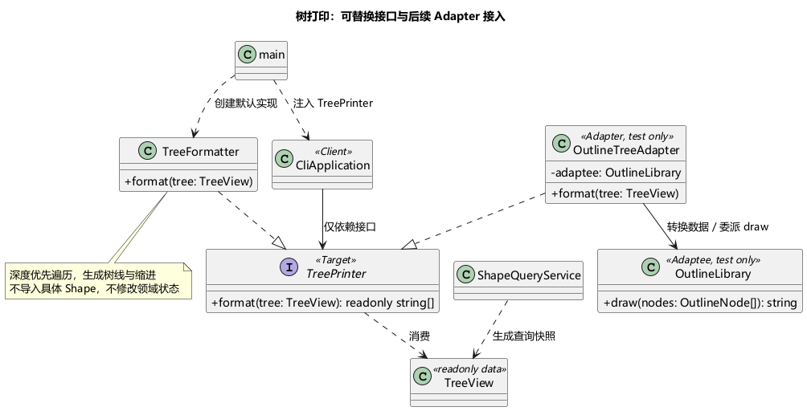
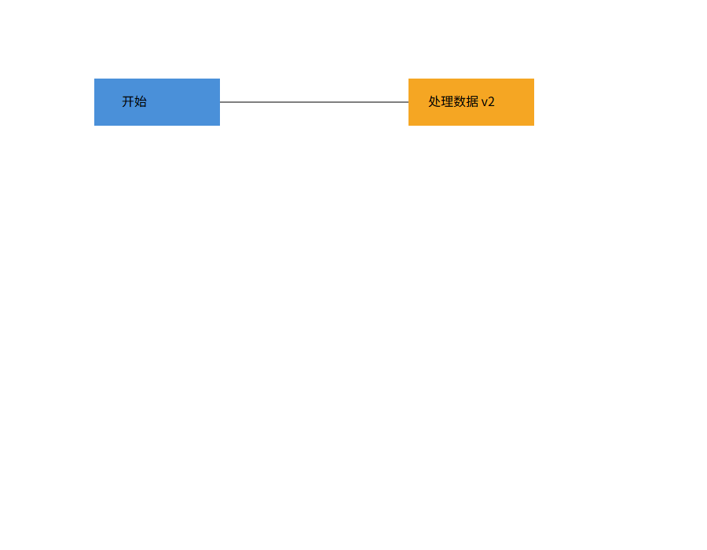

# Phase 1：SVG CLI 编辑器提交文档

## 1. 架构方案

### 1.1 模块划分

| 目录 | 职责 | 代表类 |
| --- | --- | --- |
| `src/cli` | 逐行输入、切词、命令构造、文本排版、统一错误输出 | CliApplication、Tokenizer、CommandDispatcher、TreeFormatter、ShowFormatter |
| `src/application` | 用例编排、候选文档事务、快照历史、查询与外部能力协议 | EditorSession、CommandInvoker、HistoryManager、ShapeQueryService、ShapeFactory |
| `src/domain` | 图形行为、唯一 ID、树结构、父关系与几何约束 | Shape、NumericShape、ContainerShape、六个具体 Shape、SvgDocument |
| `src/infrastructure` | 各图形的输入输出映射、SVG XML 编解码、文件读写 | 六个 Provider、NumericProvider、SvgReader、SvgWriter、FileDocumentStore |
| `src/main.ts`、`src/EditorRuntime.ts` | 程序启动与依赖装配，注册六种内置类型 | EditorRuntime |
| `tests` | 领域、历史、Provider、IO、CLI、分层约束测试 | 测试专用第七类型位于 support |
| `examples` | 作业会话脚本、外部 SVG 夹具与生成结果 | session.txt、flowchart.txt |


[PlantUML 源码](diagrams/architecture.puml) / [SVG 图](diagrams/architecture.svg)。PNG 随仓库保存，Markdown 阅读不需要配置 PlantUML 插件。

### 1.2 设计模式与实现

**Command（作业明确要求）。** 客户端构造命令，调用器只调用命令协议，命令把动作交给稳定的接收者。

| 课程角色 | 本项目对应 | 代码职责 |
| --- | --- | --- |
| Client | EditorRuntime + CommandDispatcher | 前者装配接收者与调用器；后者按输入构造具体命令，不执行 |
| Invoker | CommandInvoker | 调用 execute，并在成功后提交候选文档、登记历史或建立屏障 |
| Command | Command 接口 | execute 返回 CommandResult，可同步或异步 |
| ConcreteCommand | MoveCommand 等 | 持有参数和接收者；编辑命令经 EditCommand 间接实现接口 |
| Receiver | EditorSession | 定位当前候选文档，委派给 SvgDocument 和 Shape 的领域行为 |


MoveCommand 不计算圆心、不遍历组，也不访问终端和文件系统。它只调用 receiver.move(id, dx, dy)。快照替换文档后，后续命令仍通过相同 Session 按 ID 定位新对象。

**Composite（作业明确规定容器与叶子统一操作）。** RectShape、CircleShape、EllipseShape、LineShape、TextShape 各自表达几何。GroupShape 继承 ContainerShape，move/scale 递归委派；set 只改组自身样式，让 SVG 继承生效。叶子没有插入或删除子节点的能力。容器 children 返回副本；父关系与全局 ID 索引由 SvgDocument 维护。

NumericShape 是具有封装状态和验证行为的实现基类，提供有限数检查、几何属性白名单与原点缩放；它不是公共数据袋。具体 Shape 明确声明自己的字段、尺寸约束、平移坐标和 clone 行为。Line 平移两端，Text 平移位置，形状的宽高或半径不被 move 改变。

**Memento 与 Template Method（项目自行选择）。** EditCommand 的模板负责开启候选文档、调用具体动作、验证并准备前后快照。HistoryManager 管理命令记录，undo/redo 恢复深复制快照，不做浮点逆运算。失败时丢弃候选，文档、路径、历史栈、屏障均不变。完整快照的空间成本约为 O(NH)，适用于本阶段小文档；没有实现差量压缩。

**图形工厂与 Provider。** ShapeFactory 是唯一图形名称注册点。ShapeProvider 的 create/fromSvg/inspect/toSvgElement 处理类型输入输出映射；几何与树结构算法仍在领域层。这是扩展协议，**不声称是 GoF Adapter**。本实现不采用经典 Visitor，因为作业 §4.4 已说明后续 box 扩展；避免每增加一个图形就扩充所有 Visitor 的 visitXxx 接口。


SvgReader 先按文档顺序分配全部缺失 ID，再后序构造子树；Provider.fromSvg 显式接收已构造 children，未来复合类型能在构造时校验和绑定内部部件。

Provider 带 accepts 类型守卫，工厂在创建、读入、查询、序列化时检查 typeKey 和运行时类型。泛型闭包封装通过检查的具体类型，没有在通用输出器中使用按图形类型的 switch。测试同时检查静态错误配对和运行时伪造对象。

ShapeQueryService 递归构建新的只读查询结果；CLI 依赖 TreePrinter 接口，由 main 注入默认 TreeFormatter 生成树线与缩进；ShowFormatter 仅显示一个节点。新增文本树格式实现 TreePrinter 即可，不改命令和领域。若现成库的 API 不兼容，包装它的 Adapter 实现 TreePrinter，现成库才是 Adaptee。详见 [树打印实现和扩展说明](tree-printing.md)，测试已验证 OutlineTreeAdapter 接入不同 API 的 OutlineLibrary。



SvgWriter 递归写 XML，属性映射来自 Provider。领域层不知道树线、引号、SVG 标签字符串或终端摘要。

### 1.3 依赖方向与分派约束

- CLI 可以依赖 application 和 domain 的公共验证/错误类型；不依赖具体图形或基础设施。
- application 可以依赖 domain 和自己定义的 ports/providers 协议；不导入 Node IO、CLI 或具体基础设施。
- infrastructure 实现 application 协议，可以读 domain 的只读数据；不依赖 CLI。
- domain 只依赖 domain，不导入 Node、XML 库、应用层或输出器。
- 只有根目录装配模块连接全部层。Node 终端 IO 在 CLI，文件 IO 在 infrastructure。

按名称选择实现仅保留作业允许的两处，均标记为后续重构点：

| 标记 | 位置 | 当前策略与后续变化 |
| --- | --- | --- |
| D1 | CommandDispatcher | 固定命令构造表；未来有动态命令插件再抽离注册机制 |
| D2 | ShapeFactory | 单一 Provider 注册表；未来插件加载器复用 register |

属性白名单校验、XML 根元素校验和可选 `in` 语法识别不构成新的“类型名到类”分发点。

### 1.4 已确认的语义与变化点

以下属于与用户确认的项目选择，不能误写成作业原文明示：

| 问题 | 实现决定 |
| --- | --- |
| 文档操作后历史 | 成功 init/read/save/canvas 修改清空两栈并禁止 undo/redo，下一次成功编辑解禁；canvas 查询不建立屏障 |
| 分组父级和位置 | 同父在最早选中节点处；跨父挂到各原父节点的最低公共祖先、最早相关分支之前；子节点取操作前文档深度优先顺序 |
| 画布参数 | init/canvas 仅 0 或 2 个参数，画布尺寸有限且大于 0 |
| 启动时 help | help 可在没有文档时使用，其余依赖文档命令要求 init/read |
| save 默认路径 | 仅使用当前文档最近成功 read 的路径；显式 save 不更改它，init 清除它 |
| 组样式 | set g 只设置组自身，不覆盖子节点已设置样式 |
| 边界 | 几何尺寸和 stroke-width 可以为 0，不可负；group 至少一个目标且不可重复 |
| 无可见变化的编辑 | 成功 move 0 0、重复 front 等仍是一个历史单元 |
| 成功反馈 | move 显示增量；undo/redo 显示 undone/redone 与原操作摘要；语义与例子一致，不逐字复制样例提示 |
| SVG 缺少属性 | width/height 默认 800/600；缺失几何属性补 0；数值接受有限十进制/科学计数，拒绝单位后缀和百分比 |

SVG 范围：根 svg、六类内置图形、嵌套 g、id 和公共样式；text 保留子文本与实体。保存写出规范 width/height/viewBox。仅接受与尺寸一致的 `viewBox="0 0 w h"`。不支持 transform、CSS style、font-size、text-anchor、path、外部资源、DOCTYPE；发现不支持的视觉属性立即拒绝整份读入。根 id 等范围外属性也明确报错。这意味着作业 §0 背景变换示例不属于当前导入子集；§6 与 §6.1 A 属于验收范围。

自动 ID 先预留全文件显式 ID，再按标签序号分配，跳过未来节点已经占用的名称；只有完整导入成功才输出警告。`<g data-kind="box">` 在没有插件时降级为普通 g，其子树保留，重新保存去掉标记，避免误称仍具有 box 语义。

文件保存先写同目录随机临时文件再 rename；普通写入/替换失败不建立历史屏障并清理临时文件。当前不承诺断电持久性，不额外实现 fsync 或多进程编辑协调。

| 预期变化 | 已留出的边界 | 当前不实现的内容 |
| --- | --- | --- |
| 新图形/box | Shape 多态、ContainerShape、Provider 与 register；测试中第七类型完整通过 | 动态插件发现、box 内部部件与特殊 set 传播；生产仅六类 |
| GUI/agent 入口 | 应用命令与 Session 不依赖 stdin/stdout | GUI、网络服务 |
| 树打印形式改变 | TreePrinter 注入接口，必要时 Adapter 包装现成库 | 当前无动态插件发现；测试专用替代实现验证边界 |
| 新增输出能力 | 外层 Provider 与通用 Writer | 超出既有数据协议的能力仍可能要求补 Provider 方法 |
| 文档规模变大 | HistoryManager 独立 | 差量快照、历史容量限制 |
| SVG 支持扩大 | SvgReader/SvgWriter 与文件存储分离 | CSS/transform/path 完整兼容 |
| 存储更换 | DocumentStore、DocumentReader、DocumentWriter 协议 | 云存储与数据库 |

## 2. 过程记录

[逐步开发记录](development-log.md) 保存真实执行过程；下面归纳有代表性的讨论与纠正。

| 发现或质疑 | 证据与处理 | 结果 |
| --- | --- | --- |
| 原方案分层与 Command 角色不够清楚 | 用户对照课程 PPT 提问；拆开 Dispatcher 构造与 Invoker 执行，增加角色图 | 实现中角色分离，测试确认构造 init 不会创建文档 |
| Visitor 类图复杂、增加类型要修改很多 visit 方法 | 核对作业 §4.4 后续 box，用户要求避免后续大修 | 改为行为多态 + 外层 Provider；没有在领域放展示格式 |
| Adapter/definition 命名含混 | 用户追问是否采用 Adapter，以及不同 Shape 操作差异 | 统一 Provider 名称；只把共同语义放入 Shape，特殊属性留给具体类型 |
| UML 在 IDE 渲染失败 | 缺少 plantuml.jar 配置 | 独立 .puml 并提交 PNG/SVG，阅读文档不需插件 |
| 撤销可能引入浮点误差或引用旧节点 | 稳定 Session + 深快照；用 0.1 与 0.2 的移动验证 | 精确恢复原值，失败编辑保留 redo |
| front/back 后直接在领域文档分组顺序不正确 | 回归用例先失败：得到 a,b,c，期望 c,b,a | 重排后重建索引，测试通过 |
| PowerShell/npm 与沙箱环境 | npm.ps1 执行策略阻止运行；git 初始化后沙箱 helper 故障 | 使用 npm.cmd；必要命令通过显式提升权限执行，没有修改全局执行策略 |

实际分步提交包括：方案基线 d6f2e07、工程 49ad880、领域 731ee82、命令/Provider ed39105、SVG b46d7ce、CLI 31a0274、扩展与顺序修复 fc73e9c。树打印扩展 e2c59f2、复合导入修正 2a41f11、原文回放 41f6382 也已分别提交。后续文档与验收提交可通过 `git log --oneline` 查看。没有伪造提交时间或制造事后拆分的开发历史。

TDD 是本项目选择的方法，作业并未强制要求。实际红灯例子：Circle.move 未实现、undo 未实现、重排后分组顺序错误、CLI 忽略替代树打印器、父 Provider 缺少已导入的 children；均运行确认失败后修正为绿灯。IO/CLI/Provider 使用集成与契约测试，不宣称所有代码都逐行 TDD。

## 3. 一致性自查

| 检查项 | 实际结果与证据 |
| --- | --- |
| 模块目录 | 与分层方案一致；实际协议放 application/providers（计划图曾写 application/shapes），根增加 EditorRuntime 集中装配；图已同步；DocumentSnapshot 草案类简化为私有保存的 SvgDocument 深复制，不新增仅包装一层的类型 |
| 开发步骤 | 为测试命令端到端行为，Provider 先于 SVG IO 落地；结构领域规则在 P1 完成，命令接线在 P2/P3 完成；职责没有改变 |
| 一类一文件 | TypeScript AST 测试检查 src 顶层类数与文件名；协议文件可以含多个 interface |
| 依赖方向 | AST 自动检查所有静态 import；另人工查看 Writer/Formatter 未导入具体图形，领域没有 IO/格式化依赖 |
| Command | Invoker 只依赖 Command 协议，具体命令没有几何/树算法；Session 委派领域对象 |
| 树打印扩展 | main 注入 TreePrinter；测试用已有库 Adaptee 与 Adapter 验证替代格式、子树与状态不变 |
| 类型分派 | 手工复查 D1/D2 为唯一命令/图形名称注册点；输出器无按图形枚举的 switch |
| 字段封装 | 领域字段 private/#private；样式、几何、children 查询返回副本；结构修改走领域方法 |
| 类型扩展 | tests/support 的 MarkerShape/MarkerProvider 只在测试注册；创建、查询、读写、变换与快照通过，生产未注册第七类型 |
| 领域展示边界 | Shape 不返回 tree/show 文本；Provider 输出只读视图，CLI 排版 |
| 历史原子性 | 每类编辑往返、递归中途数值溢出、读写失败、失败导入、屏障和默认路径均有断言 |

历史 Visitor 图仅保留讨论记录并标注弃用，不是当前实现架构。原 plan 文档中“尚未实现”描述的是当时审查阶段，当前实施状态以本文和代码为准。

## 4. 质量保证手段

### 4.1 可复现验证

在项目根目录执行：

```sh
npm ci
npm run check
node tools/replay.mjs
```

`check` 顺序运行严格 TypeScript 检查、Node test runner + tsx 测试、生产构建。依赖使用确切版本并提交 package-lock.json：saxes 6.0.0；开发使用 TypeScript 5.9.3、tsx 4.20.6、@types/node 24.10.0。saxes 只解析文本，不拉取外部 DTD；应用额外拒绝 DOCTYPE。

本机验证环境：Windows、Node.js 24.14.0、npm 11.9.0。27 项测试已通过，类型检查和构建通过；[实际检查输出](validation/check-output.txt) 已随仓库保存。测试数量不等于需求数量，多个表驱动测试覆盖多类形状或命令。

| 需求 | 验证文件/证据 |
| --- | --- |
| 几何、白名单、深复制、Composite | tests/domain/geometry.test.ts |
| ID、循环、分组顺序、解组位置 | tests/domain/document.test.ts、reorder.test.ts |
| 编辑撤销重做、失败原子性、屏障 | tests/application/history.test.ts、structure.test.ts、tests/cli/history-barrier.test.ts |
| 六类映射与第七类型扩展 | tests/infrastructure/providers.test.ts |
| SVG 往返、警告、恶意/无效 XML、IO 和默认路径 | tests/infrastructure/svg.test.ts |
| 复合 Provider 获得完整子树、预序 ID 与后序导入 | tests/infrastructure/composite-import.test.ts |
| 带引号输入、中文、路径、颜色、in、tree/show | tests/cli/cli.test.ts |
| 可替换打印器与已有库 Adapter | tests/cli/tree-printer.test.ts |
| 全部命令的未初始化错误、原文会话 | tests/cli/assignment.test.ts |
| 类名文件名与依赖规则 | tests/architecture/dependencies.test.ts |

使用真实临时目录验证 Windows 已有文件覆盖、目标为目录时失败、失败临时文件清理。替身存储还验证失败读写保留文档、历史与路径。类型扩展检查包含 `@ts-expect-error` 编译期反例，不仅运行期断言。

### 4.2 会话与视觉验证

- [作业 §6 实际输出](validation/session-output.txt)：两条预期错误，保存 5 个元素，读回外部文件 7 个元素且补 ID 警告一次。
- [作业 §6.1 A 实际输出](validation/flowchart-output.txt)：8 个元素，组移动后撤销恢复 y=100，标签更新为“处理数据 v2”。
- [生成的 demo.svg](../examples/demo.svg) / [flowchart.svg](../examples/flowchart.svg)。
- 实际运行 `npm.cmd run cli` 验证 `svg>` 提示符、连续输入 init/create/show，以及 Ctrl+C 正常退出。
- 独立无界面 Chrome 实际打开生成的 flowchart.svg，截图如下；已人工查看两个彩色节点、中文标签和连线，未把解析通过等同于视觉通过。



### 4.3 提交状态与限制

已按功能里程碑逐次提交并推送到 [GitHub 仓库](https://github.com/xinyue-huang0710/2026software-design-pj_hxy)。远程初始 README 提交通过普通 merge 保留，未强推、未压缩开发历史。最终交付使用 `final` 标签，定位方式为 `git show final`；可通过 `git ls-remote origin refs/tags/final` 检查远程。

用户提供的 eLearning 作业说明截图明确截止时间为 **10 月 25 日 23:59**（按当前课程年份记为 2026 年）；本次实现和验收日期为 2026 年 10 月 16 日。最终标签在本轮文档提交和最后验证完成后创建、推送，实际指向与时间以 Git 标签为准。

作业没有 GitHub/Gitee 仓库命名要求，也没有要求公开仓库。当前 npm 包名为 svg-cli-editor。需要确保教师能够访问所提交的仓库；本项目不代填课程平台提交记录。

### 4.4 eLearning 作业说明补充核对

来源：用户提供的 eLearning 作业说明截图；保留原始 phase_cli_1.md 不作改写。

| 截图要求 | 与作业文件的关系 | 当前交付 |
| --- | --- | --- |
| CLI SVG 编辑器及创建、读写、编辑、结构查看、撤销重做 | 是原文 §2–§6 的概述，没有新增命令 | 六类图形、19 个命令；需求覆盖与回放见 §4.1–§4.2 |
| Git 管理、推送远程、历史体现开发过程、最终版本 final 标签 | 与原文 §1.1 一致 | 已按里程碑提交并推送，修正后 final 跟随最终验收版本 |
| 工程 doc/README.md 使用 Markdown | 与原文 §1.2 一致 | 本文件 |
| 架构方案、与 AI 协作过程、一致性自查、功能完整性及质量保证 | 与原文 §1.2 一致；截图再次强调功能完整性 | 本文四节、需求覆盖表、测试及示例回放证据 |
| 截止时间 10 月 25 日 23:59，共两周 | 补充原文件未写明的具体截止时间 | 已同步到本文与 plan.md；标签需在此前完成 |

截图展示的是作业说明，没有展示 eLearning 的提交输入框、附件要求或最终提交按钮。因此不能据此断言“只填链接”“必须传 ZIP”或“推送 GitHub 就等于已在 eLearning 提交”。目前已完成仓库交付，尚未在 eLearning 执行提交；具体平台操作需以实际提交区为准。

以下是可填写到 eLearning 文本框的交付信息（如果该提交区接受文本/链接）：

```text
项目：PJ1 Phase 1 — CLI SVG 编辑器
代码仓库：https://github.com/xinyue-huang0710/2026software-design-pj_hxy
最终版本：https://github.com/xinyue-huang0710/2026software-design-pj_hxy/tree/final
项目文档：https://github.com/xinyue-huang0710/2026software-design-pj_hxy/blob/final/doc/README.md
运行：npm ci；npm run cli
验证：npm run check（27 项测试、严格类型检查、构建通过）
```

这是准备好的交付信息，不代表平台已接收作业。截图未要求额外报告、演示视频或压缩包，未据此增加未明确要求的材料。