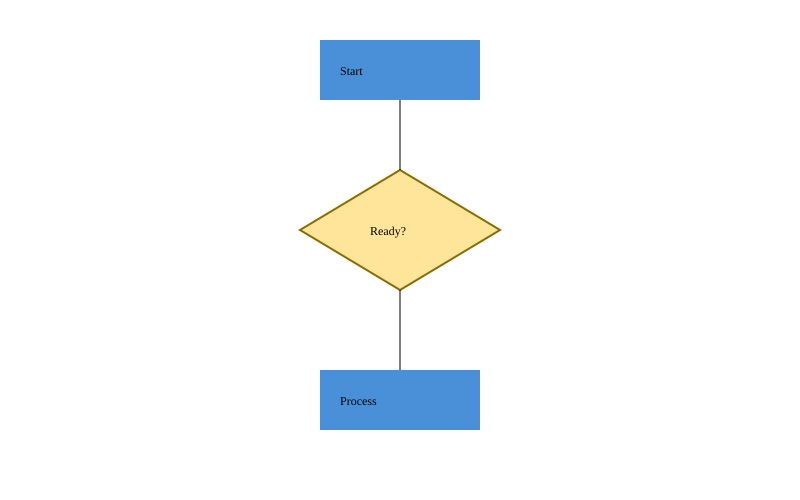

# Phase 2 选做：diamond 判断框插件

作业末尾允许再注册 diamond/arrow/swimlane 等一种形状接入同一内核。本项目选择 diamond，实际实现独立插件，而非只增加示意图。作业说明选做会在评语中反馈、不改变评分权重，本文不承诺额外分数。

[统一交付标签 p2](https://github.com/xinyue-huang0710/2026software-design-pj_hxy/tree/p2) 包含必做、diamond 选做及补充文档。该标签曾提前创建，后更正到完整交付，原指向和原因见 [标签更正记录](tag-correction.md)。

固定选做代码版本：[fd98ffd](https://github.com/xinyue-huang0710/2026software-design-pj_hxy/tree/fd98ffd4902b8c0626b69a5d75f7a29d6c2cb65d)。该版本已包含选做源码、集成测试、示例和验收日志；本文与自动指标随后以纯文档提交补齐。完整检查：48 项 CLI 测试、2 项解析测试通过。

## 1. 使用方法与完整示例

在仓库根执行 npm ci、npm run build，再启动任一种装配：

~~~sh
npm run cli
npm run cli -- --config plugins.config.json
~~~

两种默认装配都已包含 @svgframe/plugin-shape-diamond。

~~~text
init
create diamond decision 400 230 200 120 #fff2cc
set decision stroke black
set decision stroke-width 2
move decision 10 20
undo
set decision width 240
show decision
tree
stats
save examples/my-diamond.svg
~~~

语法：create diamond <id> <cx> <cy> <width> <height> [fill] [in <containerId>]。cx/cy 为中心，width/height 为外接矩形宽高；顶点依次为上、右、下、左。尺寸非负，允许零尺寸退化形状。scale 按原有约定相对画布原点缩放中心及宽高，不是只放大外形。

支持几何属性 cx、cy、width、height，及 fill、stroke、stroke-width；未定义的 label 等属性会被拒绝。判断框文本可单独创建 text，与 diamond 放进同一 g。菱形本身是叶子，因此 stats 计为 diamond，不能作为 in 的目标容器。

完整流程图输入：[examples/diamond.txt](../examples/diamond.txt)。包含 box、diamond、text、line，展示移动/缩放撤销、属性修改、统计、保存及重新读入。输入只含命令和注释。

[查看 SVG 文件](../examples/diamond.svg)。输出由实际 CLI 保存，默认装配无需手写 SVG；普通浏览器可打开。CLI 大纲原有六种图形的帮助信息不枚举新类型，新增语法在本插件文档明确给出。

## 2. 插件实现与边界

| 文件 | 职责 |
|---|---|
| [DiamondShape.ts](../plugins/shape-diamond/src/DiamondShape.ts) | 封装中心与尺寸，计算四个顶点，移动/缩放/修改/克隆；赋值前检查所有候选值及顶点有限性 |
| [DiamondProvider.ts](../plugins/shape-diamond/src/DiamondProvider.ts) | 参数解析、只读展示映射、标准 polygon 保存与严格读回 |
| [DiamondPlugin.ts](../plugins/shape-diamond/src/DiamondPlugin.ts) | 通过现有 context.registerShape 注册 Provider |
| [package.json](../plugins/shape-diamond/package.json) | contributes.shapes=["diamond"]；唯一运行依赖为 @svgframe/core |

不导入内核内部实现、宿主或既有插件。单位测试只使用该插件和公开 core API，不依赖 box/rect 等实现。没有为 diamond 增加新的核心接口、类型判断分支或属性白名单项。

标准 SVG 输出使用 polygon，而不是浏览器不认识的 diamond 标签。points 决定实际绘制；data-kind="diamond" 供工厂选择 Provider，data-cx/data-cy/data-width/data-height 保存精确模型数值。

**为什么保留几何元数据：** 如果仅从顶点求中心和宽高，小数浮点相减可能在往返后改变原值。读回根据元数据重建对象，并验证 points 与计算顶点逐项相等；因此既保留模型精度，也不静默忽略冲突的可见形状。支持空白/逗号分隔及等值数字写法，但要求四点按上、右、下、左顺序排列。

只支持本插件输出的轴对齐判断框，不把任意 polygon 猜成 diamond。缺少元数据、顶点不匹配、非有限数、负尺寸、不支持属性、文本或子节点均拒绝整次读入，保留原文档和历史。

禁用插件时 create diamond 报未注册类型，读入 polygon 报不支持类型；不会猜测为矩形或静默丢弃。box 的普通 g 降级规则属于它自己的要求，不扩展成所有自定义图形都能无损降级的承诺。

## 3. 可扩展性与两种装配

- A：只在 packages/host/src/composition/codePlugins.ts 增加 DiamondPlugin 的导入和安装。
- B：plugins.config.json 新增插件项；模块解析和注册校验使用原有加载器。
- 宿主 package.json 和锁文件登记新增 workspace 依赖。
- 内核、加载器、树/详情渲染器、SVG 读写器及全部既有插件都不修改。

stats 自动按 typeKey 计数；星号插件读取统一内容快照；历史恢复依赖多态 clone，均无需识别 diamond。相关行为通过真实装配集成测试验证。

[Git 差异证据](validation/diamond-diff-proof.json) 由 [verify-diamond-diff.mjs](../tools/verify-diamond-diff.mjs) 从提交对象生成。脚本验证每个原有目录在两端存在，并检查原有运行源码只有组合根变化，避免拿空路径的 diff 充当证明。

在配置中给 diamond 项加 enabled:false 后用 B 启动，可单独禁用，其他插件保留。--builtin-only 则禁用全部可选插件。

## 4. 验证与开发过程

先写几何和 SVG 契约测试，运行时因 DiamondShape 文件尚未实现而失败；完成插件后两项测试通过。随后接入 A/B 装配，增加集成与全文回放测试。没有把这个初始缺模块错误描述成几何算法已被测出错误。

~~~sh
npm run check
node tools/replay-diamond.mjs
node --import tsx --conditions=development --test tests/plugins/diamond-unit.test.ts
~~~

新增 5 项测试：

1. 几何顶点、原点缩放、样式独立克隆、非法参数及溢出操作的原子性。
2. Provider 独立参数校验、精确小数往返、损坏 polygon 拒绝。
3. 真实分组/排序/移动/缩放/属性/删除的 undo/redo，以及 stats、星号、SVG 读回。
4. 未装插件时创建/读入失败不污染原文档与历史。
5. 编译后 A/B 完整示例的 stdout 与 SVG 逐字节一致，单独禁用配置仍保留其他插件和撤销能力。

[双装配摘要](validation/diamond-assembly.json) 记录字节数和 SHA-256；[预期终端输出](transcript/optional/diamond.expected.txt) 和 [预期 SVG](transcript/optional/diamond.expected.svg) 单独保存。常规回放只校验，--update 才重生成。完整检查日志另存为 [optional-check.txt](validation/optional-check.txt)，保留此前的必做验收证据。

选做指标单独保存于 [docs/metrics/optional](../docs/metrics/optional/README.md)，以原必做提交 e2fa573fa72f882e398178bf5c199531fd9810ed 为固定基线，与选做代码提交 fd98ffd4902b8c0626b69a5d75f7a29d6c2cb65d 比较，避免标签更正改变基线。根目录 [docs/metrics](../docs/metrics/README.md) 报告 final 到完整交付代码的指标，已包含 diamond。两份报告均由 Git 历史脚本生成。
