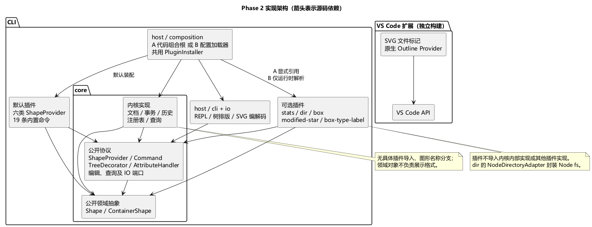

# PJ1 Phase 2：插件实践与插件式重构计划

状态：审查稿，尚未开始 Phase 2 实现。本文依据 [Phase 2 要求](pj1-phase2/phase_cli_2.md)，结合 [Phase 1 要求](phase_cli_1.md) §4.4、§6.1 和现有源码制定。下文标明哪些是作业要求，哪些是本方案选择；接口名称和新路径是拟定设计，不代表已经实现。

## 1. 这次需要完成什么

**两部分都必做：一个 VS Code 扩展，以及现有 CLI 的插件式重构。** 不是只增加 box，也不要求做完整图形界面。

| 范围 | 必做内容 | 验收证据 |
| --- | --- | --- |
| VS Code 扩展 | Explorer 中 SVG 文件显示 []；原生 Outline 展示嵌套元素、源码定位、编辑更新、处理不完整 XML | 源码、运行步骤、示例、真实运行截图、模式分析和 Phase 1 复用评估 |
| 四个扩展点 | ShapeProvider、Command、TreeDecorator、AttributeHandler；接口在内核侧，实现为类 | 注册/调用/缺省行为/违规处理测试；文档列出实际文件和函数 |
| 命令插件 | stats、dir，分属独立插件包，可以分别禁用 | help、输出顺序、历史不变、双装配；dir 的 Adapter 及替身/真实文件系统测试 |
| 图形插件 | box 及 fill/label 属性语义、递归组合、读回降级、结构保护 | Phase 1 版本 B 会话、边界测试、接入提交的 Git 差异 |
| 树标签 | modified-star 与 (box) 独立插件、同时生效 | 状态机测试；无标签时 Phase 1 输出逐字节不变 |
| 两种装配 | A：代码组合根；B：根目录 plugins.config.json | 共用注册校验流程、失败回滚、A/B 独立接入提交和逐字节回放 |
| 交付 | 同仓库，最终 p2；doc/README.md、PlantUML、至少 3 条 ADR、自动指标 | docs/metrics/ 从 Git 历史生成；保留真实开发过程 |

Phase 2 明确规定：**既有 tag 不得移动**。当前 final 指向 f8f366c8260ae9a2d8105f33ba1486570e5a1933，作为兼容性与指标基线保留；只有收尾最终提交才打 p2，中间节点使用普通 commit。

本文档没有给出 Phase 2 截止日期，也没有新增 eLearning 上传规则；不沿用 Phase 1 的 10 月 25 日作为本阶段截止日期。diamond、arrow、swimlane 等属于选做，先完成必做项。

## 2. 现有架构能复用什么

基线复核（2026-11-07）：已运行 npm run check，类型检查通过，27/27 项测试通过，构建通过；本轮未修改业务源码。

整体是**保留领域行为和编辑事务，调整扩展边界及装配方式**，不用重新设计所有图形操作。

| 现有实现 | Phase 2 处理 |
| --- | --- |
| Shape、ContainerShape 的几何多态与组合语义 | 保留，补通用结构不变量校验；领域层继续不负责终端、XML 或树标签 |
| ShapeProvider、ShapeFactory | 沿用注册思想；内置六类移到插件包，补公开上下文、manifest 校验及插件安装事务 |
| EditorSession、EditCommand、HistoryManager | 保留候选文档和快照机制；插件通过公开用例接口访问，不导入 Session 内部实现 |
| CommandDispatcher 中的具体命令构造和参数分支 | 改为命令注册表；命令插件提供参数规则、构造逻辑与 help |
| SvgDocument 直接 new GroupShape | 消除具体类型依赖；内部文档根单独建模，普通分组实例由内置命令经公开图形工厂取得 |
| TreePrinter、TreeFormatter | 保留整棵树输出可替换能力；增加逐行装饰入口，框架阶段完成后冻结 |
| SvgReader / SvgWriter | CLI 继续复用；完善 data-kind 降级与插件输入校验，保持原有 SVG 子集规则 |
| 测试、样例、静态架构图 | 保留；从 final 提取原始输出基线，不用修改后的程序生成“旧版预期” |

**不引入经典 Visitor。** 新图形仍通过 ShapeProvider 加入，避免每增加图形就修改所有 visit 方法。几何操作由各图形多态完成；创建、读回、显示映射交给外部 Provider。

树打印的两个扩展方向要分开：
- TreePrinter：替换整棵树的排版方式，例如以后换成另一种树打印库。
- TreeDecorator：只为节点行和标题行追加标签，本阶段必须新增。

## 3. 分层、包边界与依赖

建议用 npm workspaces 管理本地包，不必发布到 npm。保持 TypeScript、类封装、一类一文件；保留根目录 npm run cli、npm run check 的使用入口。

~~~text
packages/
  core/src/
    domain/                  # Shape/ContainerShape、文档、领域校验
    application/             # Session、Invoker、History、查询与注册表
    contracts/               # 四个扩展点、公开用例/查询/IO 协议
    index.ts                 # 有限的公共导出
  host/src/
    cli/                     # REPL、通用 token 化、tree/show 格式化
    io/                      # SVG 编解码、文件存储
    loading/                 # 通用配置读取、模块解析、插件安装事务
    composition/
      codePlugins.ts         # A 唯一可改的插件装配文件
      bootstrap.ts           # 默认内置装配；选择 A 或 B
plugins/
  builtin-shapes/             # 六类图形及 Provider（可以共用一个包）
  builtin-commands/           # Phase 1 的 19 条命令、参数及 help
  command-stats/
  command-dir/                # DirCommand + NodeDirectoryAdapter
  shape-box/                  # BoxShape、BoxProvider、两个属性处理器
  tree-modified/
  tree-box-label/
extensions/svg-tools/        # VS Code 扩展及其测试
tools/metrics/               # Git 历史指标生成脚本
doc/                         # 报告、ADR、截图、回放输入与预期
docs/metrics/                # 作业指定的指标输出位置，注意是 docs
plugins.config.json
~~~

[PlantUML 源码](doc/diagrams/phase2-architecture.puml) · [SVG](doc/diagrams/phase2-architecture.svg)

依赖规则：

1. 内核不导入宿主、具体插件、Node 文件系统或 VS Code。
2. 插件只能使用 core 的公开领域抽象和协议；不从内部文件路径导入 Session、HistoryManager 等。
3. 具体六种图形与 box 位于插件侧；内核通过类型注册与容器能力协作，不维护具体图形枚举。
4. host 负责运行环境、IO 和装配。只有代码组合根可显式引用具体插件；配置加载器没有插件名称表。
5. VS Code 扩展独立构建、独立激活，不启动 CLI，不依赖 Node CLI 宿主。
6. 用包 exports、类型检查和 import 边界检查约束依赖，不只靠目录名字宣称隔离。

这次目录迁移集中在“框架可扩展”提交阶段，记录旧新路径映射；后续新增插件提交不再夹带迁移。共用内部工具只在确实需要时提取，不建设热加载、远程下载、权限沙箱或依赖注入容器。

## 4. 四个扩展点的调用方案

以下表是拟定清单，完成实现后必须替换成实际文件名和函数名，补入 doc/README.md。

| 扩展点 | 内核调用位置（拟定） | 类实现 | 禁用可选插件时 | 契约与错误 |
| --- | --- | --- | --- | --- |
| ShapeProvider | ShapeFactory.create / fromSvg / inspect / toSvgElement | 六类 Provider、BoxProvider | 六类内置图形保留；create box 按原文报未知类型 | 注册类型唯一；返回 id/type 一致；新子树整体校验失败不插入 |
| Command + CommandRegistration | CommandRegistry.create → CommandInvoker.execute | 内置命令、StatsCommand、DirCommand | 原 19 条命令和 help 保留；可选命令为 unknown command | name 唯一；插件负责参数校验，查询无历史副作用 |
| TreeDecorator | TreeDecorationService.decorate，遍历有语义标识的行节点 | ModifiedStarDecorator、BoxTypeDecorator | 标签列表为空；原始 tree 字节不变 | 不修改输入视图；固定顺序；只返回单行标签，不允许换行破坏结构 |
| AttributeHandler | AttributeService.set，位于编辑候选文档事务内 | BoxFillHandler、BoxLabelHandler | 无命中则按原来的图形属性规则处理 | handles 纯查询；多命中拒绝；apply 抛错整条 set 回滚，不能回落 |

接口默认行为和错误文字分开处理：作业指定的错误必须原样；未规定的冲突、插件运行违规错误集中定义为单行 error:，避免不同模块随意拼写。

### 4.1 命令与公开上下文

保留 Command 的 execute 协议，另用 CommandRegistration 提供 name、usage/help 和根据 token 构造命令的入口。不同命令语法由各自注册对象处理，内核只查注册表。

公开上下文拆成小接口：
- 查询：只读文档快照、节点/子节点、当前画布。
- 编辑：候选文档操作、属性服务；只有编辑命令事务能取得可变目标。
- 图形创建：按 typeKey 调用已注册 Provider。
- 输出与历史：通过统一命令结果交给 Invoker；插件不直接 push/pop 历史。

默认 help 的顺序与文本保持 Phase 1 原样，再按注册顺序追加可选命令。基础命令包始终是默认能力；可选插件不存在、禁用或加载失败不能导致 CLI 无法启动。

### 4.2 属性处理器与单条撤销

建议将初始接口完善为 handles(readonlyTarget, attr) 与 apply(editContext, targetId, attr, value)。这里是允许调整的方案，不照搬示例中只接收字符串却不知道如何访问对象的不足。

一次 set 的顺序：

~~~text
创建候选文档 → 取得只读目标 → 收集 handles 命中
  0 个：调用原有 Shape.setAttribute
  1 个：向该处理器提供候选文档的受控编辑接口
  多个：报属性处理冲突，不执行任一处理器
→ 校验候选文档全部不变量 → 一次提交文档和历史
~~~

handles 不提供活的可变 Shape；apply 不拿正式文档和历史栈。处理器修改两个子部件后抛错，也只丢弃候选文档，正式文档、undo/redo 与 dirty 均不变。保留当前快照方式，不为此引入事件溯源。

### 4.3 树标签与 dirty

选择“**当前内容与保存基线比较**”：
- 成功 init/read 建立干净基线；成功 save 更新基线，保存失败不更新。
- 新建节点立即标星；修改节点的祖先也标星，包括画布标题。
- undo 回到保存内容后星号消失；redo 离开保存点后重新出现。
- 删除、移动父级、同级顺序、样式、几何和画布尺寸都纳入比较。
- help、tree、show、stats、dir 不改变基线或 dirty。

ModifiedStarDecorator 将基线封装在实例字段。内核提供只读、与展示格式无关的结构快照和成功状态变更通知；插件按节点及子树内容比较，不靠解析 tree 输出，也不把星号字段加进 Shape。状态快照需含类型、属性、子节点顺序和画布；复用 Provider 的结构化数据并采用稳定比较，不使用格式化字符串。

通知在正式提交后发送，插件查询只能读状态；监听异常单独记录/隔离，不能把已经成功的编辑伪报成“失败且已回滚”。安装失败时未发布的监听也应清理。

标签按注册顺序拼接，约定 A/B 都先加载 (box)、后加载 modified-star，结果如 g#n1 (box) *。BoxTypeDecorator 只读 typeKey，不依赖 BoxShape 类，也不知道星号插件存在。

框架先生成含节点标识、正文和标签的树视图，再由 TreePrinter 排版；标题也作为可装饰视图。不要先输出字符串再靠字符匹配寻找节点。

## 5. box 如何做到后续不改内核

### 5.1 语义与实现归属

BoxShape 继承公开 ContainerShape；BoxProvider 负责创建/读回/序列化/视图；BoxFillHandler 和 BoxLabelHandler 处理两个属性。类型标签另放 tree-box-label 包，便于独立禁用与证明两个装饰器互不感知。

按 Phase 1 §4.4：
- create box n1 x y w h "标题" 创建 n1、n1-rect、n1-label；矩形默认 fill 为 #4a90d9，文字位置为 x+20、y+35。
- 通过公开图形创建端口生成 rect/text，不直接导入另一个插件包的具体类；独立测试用 Shape 替身。
- box 是容器，支持 in、整体 move/scale/delete、被 group、内部继续嵌套。
- canUngroup 返回 false，使用 error: cannot ungroup composite shape: <id>。
- fill 改内部矩形；label 改内部文本；两条命令各自一个 undo 单元。
- 以 g 和 data-kind="box" 保存；插件启用时恢复 box，未启用时降为普通 g。

### 5.2 必须提前做好通用框架能力

1. 整棵新增子树的 id 在提交前检查；三个 id 任一冲突都不能留下半个 box。
2. ContainerShape 提供通用 validateStructure 钩子，文档事务提交时调用；BoxShape 校验必需直属子部件存在且类型正确。内核不写 if box。
3. 普通 delete/addto/group 等操作不能破坏必需子部件；采用“候选状态验证失败则整条拒绝”。删除整个 box、移动整个 box 合法；内部添加其他合法子节点允许。
4. 已装插件但导入 box 缺部件/类型错误：**拒绝整个 read**；重复 id 一律拒绝。未安装时普通分组降级并保留已有子节点，不伪造新部件。
5. data-kind 是通用类型恢复元数据。普通 g 降级后保存时去掉该标记，保留 Phase 1 已测试的行为；不把未知任意 SVG 属性全部放行。此项修正了初稿“保留标记”的建议，避免重构改变旧语义。
6. 创建及属性操作的特有成功摘要需要外层 Provider/Handler 返回结构化结果或格式化策略。提前扩展相应协议，支持 Phase 1 §6.1 的 box 创建/传播/恢复文案；领域类不返回终端字符串，Session 不按 box 名称分支。
7. 现有 19 条命令的默认输出和 undone/redone 规则保持基线；box 的额外文案不能通过修改全局默认模板顺带改变旧命令。

这些属于框架阶段的工作，先用一个测试专用复合类型验证。不能到接入 box 的提交才修改内核来“补接口”。

## 6. stats、dir 与 Adapter

stats 遍历只读树，按当前子节点顺序深度优先；叶子按类型首次出现顺序统计。通过容器能力判断容器，不枚举 g/box；根不计数，box 内叶子照常计入。空文档输出 (total 0, containers 0)。

dir 的角色对应：

| Adapter 角色 | 本方案 |
| --- | --- |
| Client | DirCommand |
| Target | 内核公开的 DirectoryReader 接口 |
| Adapter | NodeDirectoryAdapter |
| Adaptee | Node 的文件系统目录读取 API |

目录适配器可随 dir 包提供，activate 在插件内部注入给 DirCommand；两种装配加载同一个包。Node 依赖留在适配器，纯命令测试只提供 DirectoryReader 替身。

采用以下约定：
- 目录取进程 cwd，独立于文档和 read/save 路径；未初始化也能运行。
- 仅直接子项，包含点开头项；目录在前、文件在后，各按确定性的名称比较排序，避免依赖机器 locale。
- 两种标记后均为两个空格，以文字要求为准：例如 [FILE]  demo.svg。
- 符号链接不跟随，采用 [LINK]  name 单独一组排在普通文件之后；其他特殊项用 [OTHER]  name，写入 ADR 并测试。
- 空目录与失败输出严格采用作业格式；失败后 REPL 可继续，文档/dirty/历史/cwd 均不变。

## 7. 两种装配、清单校验和失败回滚

### 7.1 公共安装流程

插件默认导出一个实现 Plugin 协议的类；实例激活时接收 PluginContext 和只读 options。各包 package.json 的 contributes 使用 shapes、commands、decorators、attributes，省略类别视为空列表，处理器有稳定名字。

A 组合根决定类和顺序，B 加载器从配置解析模块；两者最后都进入同一个 PluginInstaller：

~~~text
取得模块和 manifest → 创建插件实例与暂存注册上下文
→ activate → 核对各类别名称集合与重复注册
→ 一次发布所有注册及监听
失败：丢弃本插件全部暂存项/资源，保留先前成功插件，继续下一个
~~~

注册期间只允许登记扩展和资源，不允许修改正式编辑会话；执行时上下文才提供相应能力。回滚保证的是注册和框架管理资源，不宣称能撤销第三方模块任意顶层副作用，插件契约禁止这类副作用。

先完整验证配置语法和结构，再装入任何可选插件，保证配置损坏时只剩默认内置能力。enabled:false 完全跳过。数组顺序决定装配顺序；相对路径以配置文件所在目录解析；包名按模块解析规则，兼容已构建的本地 workspace 包。

动态解析与模块求值分开：顶层模块不存在才报 not found；模块已找到但内部依赖缺失或求值失败应按插件加载失败处理。不得把所有 MODULE_NOT_FOUND 一概误报为顶层模块不存在。目录模块通过其包入口定位，不假定 Node ESM 能直接 import 一个目录。

### 7.2 必须覆盖的错误

| 情况 | 输出 |
| --- | --- |
| 模块不存在 | error: plugin not found: <module> |
| 无默认导出 | error: plugin has no default export: <module> |
| manifest 不一致 | error: plugin manifest mismatch: <name> (declared: …, registered: …) |
| activate 抛错 | error: plugin failed to activate: <name> (<reason>) |
| 同类重名 | error: duplicate registration: <category>/<name> |
| 配置非法 | error: invalid plugin config |

清单的类别及名称用稳定顺序报告。测试插件先注册两项再抛错/重名/清单不符，验证两项均不可见，之前和后续成功插件仍可用。A 路径也必须测，不能仅测配置装配。

### 7.3 两个真实接入提交

推荐在框架、stats、dir 已稳定而 box 尚未加入时记录共同基线 B0：

- 分支 A：从 B0 新增 shape-box 包，只改 codePlugins.ts 一个已有运行文件；保存提交 CA。
- 分支 B：从同一 B0 新增相同的 shape-box 包，只改 plugins.config.json，已有运行源码不变；保存提交 CB。
- 必要的 package.json、锁文件、测试与文档变更逐项解释。
- 两条演示分支都保留并推送；之后合并两份装配改动。运行时 A/B 二选一，不重复安装。
- CA、CB 不混入通用框架修复；发现缺口先回框架基线修复并重新做后续真实接入，不伪造历史。

文档记录真实 hash 与 git diff CA^ CA / CB^ CB。检查内核及既有插件目录确实存在，再排除新增插件目录验证空差异，不能拿不存在路径证明“零改动”。

双装配回放使用同插件集合、顺序、options、初始 SVG 和 cwd。基础会话、box 会话、新命令会话都逐字节比较。输入文件只存命令/注释；预期输出单独保存。dir 用固定临时目录，日志放目录外。基础兼容比较关闭所有可选扩展（包括标签），与 final 输出比较。

## 8. VS Code 扩展实现方案

先在当前 VS Code 打开样例 SVG，记录已有 Outline 行为及已安装相关扩展；再在 Extension Development Host 中验证我们自己的 Provider，避免把其他扩展效果误当成本项目效果。

文件标记采用 FileDecorationProvider，返回 []；通过文件类型判断排除名为 folder.svg 的目录，不改文件内容。扩展激活不能只依赖“已打开 SVG”，应覆盖只浏览 Explorer 的情况。接口依据：[VS Code API](https://code.visualstudio.com/api/references/vscode-api#FileDecorationProvider)。

大纲采用 DocumentSymbolProvider 向原生 Outline 提供带 children 和源位置的符号树；标签为 tag#id 或 tag。不创建另一个 TreeView 冒充原生大纲。接口依据：[VS Code 符号提供接口](https://code.visualstudio.com/api/language-extensions/programmatic-language-features#show-all-symbol-definitions-within-a-document)。

复用选择：
- 继续使用已有 XML 库的解析能力；为扩展构建带源码范围的轻量语法树。
- 不直接拿 CLI SvgReader 解析编辑中的文档：它要求有限 SVG 子集、补 id、校验几何且没有源码范围；编辑大纲的目标不同。
- 不把编辑器临时语法节点变成业务 Shape，也不为复用修改文件或补 id。
- 用显式栈组织嵌套节点；未完整 XML 返回空大纲并在下一次合法请求恢复，不让异常退出扩展。
- 验证源位置的 CRLF、中文/Unicode、自闭合元素、引号内 > 和 CDATA，不能用正则解析整份 XML。
- 使用 VS Code 对文档符号 Provider 的调用机制处理更新；如引入缓存，按文档版本和取消信号处理，不返回旧版本位置。

验证嵌套 g、无 id、编辑后增删节点、无效再恢复，以及点击定位。提交真正运行的 badge 和 Outline/定位截图、异常输入记录；安装/调试步骤按实际验证结果写。

模式分析要如实：VS Code 是宿主，扩展注册 Provider，宿主反向回调。FileDecorationProvider 名字中有 Decoration，不意味着它必然是经典“相同接口对象逐层包装”的 GoF Decorator；符号/文件信息转换也要按实际接口说明 Adapter 对应关系，不能只凭名称认定。

## 9. 实施和逐步提交顺序

每步先完成相应验证再提交，遵循此前“隔一段时间一个有意义 commit”的要求。以下是建议工作单元，可按实际开发适度拆分，不能最后一次提交全部。

| 步骤 | 工作与完成条件 | 提交边界 |
| --- | --- | --- |
| P0 | 锁定 final、保存 Phase 1 回放基线、审查本方案 | 计划与基线准备 |
| P1 | 观察 VS Code；实现标记、大纲、真实验证及复用分析 | 可分标记、大纲、验证三个 commit；达到 VSCode 实践节点 |
| P2 | 工作区包结构、公共接口、内置图形/命令插件化 | 先迁移、再替换分发；保持旧测试通过 |
| P3 | 四扩展点、加载器双路径、暂存回滚、结构校验、语义快照与摘要扩展 | 用测试插件证明能力，Phase 1 全回归；首次自动指标 |
| P4 | stats 与 dir 独立包，Adapter 和真实目录验证 | 两个独立插件提交，内核冻结 |
| P5 | 从共同基线做 box 的 A/B 两份接入证明 | CA/CB；旧代码零改动约束 |
| P6 | 两个树标签分别接入，状态机与叠加测试 | 每个插件独立提交，不再改渲染器或内核 |
| P7 | 双装配全回放、指标、ADR、报告、安装步骤和证据复核 | 普通收尾 commit；最终才打 p2 并推送 |

若 P4 之后发现接口不够用，单独提交框架修复，再从修复后的基线展示插件接入。不得把修复藏进插件 commit 来满足表面流程。

## 10. 测试、ADR 与最终材料

优先为新契约和故障路径写测试，再实现：
- 原有 27 项测试继续保留；迁移后不能删掉旧边界来获得绿灯。
- 事务：多部件修改、抛错、重复 id、结构损坏，文档与两个历史栈一起核对。
- 插件：独立运行，不靠启动完整 CLI 才能测试；box 用注入工厂替身。
- 配置：四类失败、重复与回滚、坏配置、禁用模块、相对路径、options、次序、内部依赖失败。
- 回放：final 兼容、A/B 字节一致、保存 SVG 内容及重新读回。
- VS Code：解析单测 + Extension Host 集成 + 实际界面演示。测试方式参照[官方扩展测试文档](https://code.visualstudio.com/api/working-with-extensions/testing-extension)。

至少写五条 ADR：属性访问/冲突/事务、box 读回与结构保护、dirty 与祖先传播、注册清单校验/回滚、dir 排序与特殊文件策略。

交付文件：
- doc/README.md：Phase 2 总报告；保留 Phase 1 报告副本并链接 final。
- doc/diagrams/：重构前后 PlantUML 及静态 PNG/SVG，预览不依赖本地插件即时渲染。
- doc/adr/、doc/transcript/、doc/validation/：决策、输入/预期、真实证据。
- docs/metrics/：按内核/装配处/插件分类的文件职责、行数与复杂度增量。
- 指标脚本从 final 和目标提交的 Git 对象取源码，排除依赖和构建产物；VS Code 单列。记录目录迁移映射、分类规则、行数与圈复杂度的确定性算法，不能手填数字或只测当前工作树。
- 框架节点先出一次指标，收尾再生成。指标报告最后一次提交仅改报告时，生产源码树保持不变；打 p2 后重新运行 final 对 p2 的脚本校验结果一致，避免因报告引用提交号而反复移动标签。
- AI 协作记录保留实际建议、人工判断、修正与验证，不声称本计划已经完成实现或验收。

本阶段的主要风险在于**扩展契约和可核验的接入过程**。框架阶段先把事务、结构约束、输出与装配边界做完整，后面的插件才能真正独立加入。
