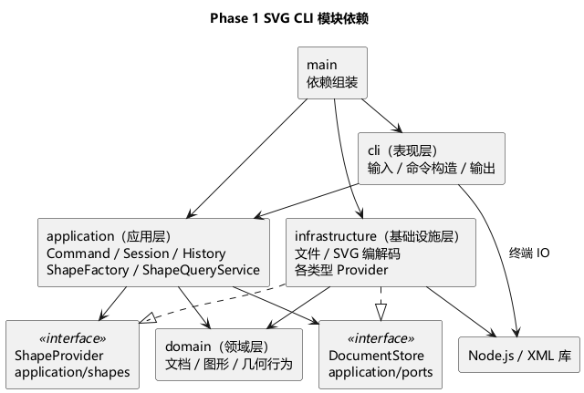
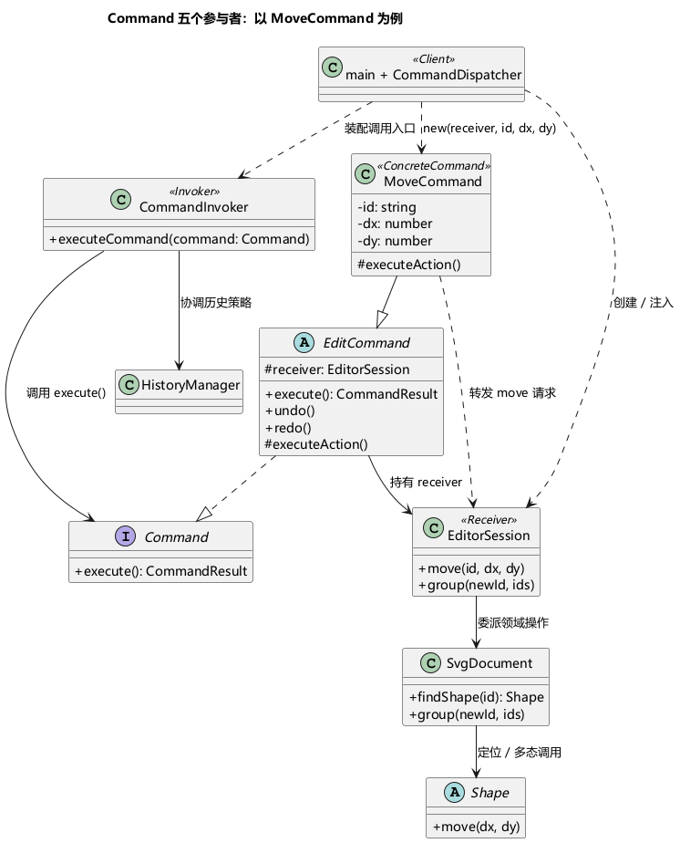
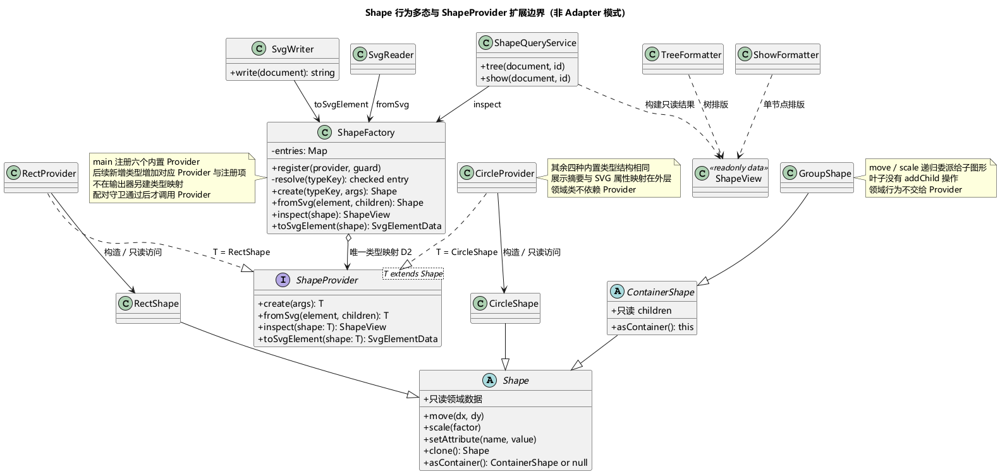

# Phase 1 SVG CLI 编辑器：需求与架构计划

状态：第 7 节 A1–A8 及补充规则已由用户确认采用；根据后续类型扩展要求，将经典 Visitor 改为图形类型提供者方案，核心功能采用 TDD；尚未开始实现。需求来源：`phase_cli_1.md`。

本文把“作业明确要求”“本方案的设计选择”“原文未确定的语义”分开记录。当前工作只产出计划；原文中的代码开发、远程推送、最终打 tag 是后续交付要求，不代表本次已经执行或获得执行指令。

## 1. 目标与阶段边界

实现一个用 TypeScript 编写的面向对象 SVG 命令行编辑器，通过 REPL 创建、组织、编辑图形，支持撤销重做以及 SVG 文件读写。评价重点不只是功能，还包括架构、设计模式、AI 协作过程和实现与方案的一致性。

### 1.1 作业的硬性要求

| 编号 | 要求 | 来源 |
| --- | --- | --- |
| R01 | TypeScript；类层次、多态、字段封装；一类一文件，文件名与类名一致 | §2.1 |
| R02 | 必须使用 Command 模式；禁止公共数据袋配合自由函数、到处按 tag 分派的实现 | §1.2、§2.1 |
| R03 | 仅允许命令分发、图形工厂两处按名称分派，且架构方案须将其标记为待重构 | §2.1 |
| R04 | 内置 `rect / circle / ellipse / line / text / g` 六种类型；容器与叶子统一操作 | §2.1、§3 |
| R05 | 图形和 g 的 id 全局唯一、大小写敏感；create/group 必填；导入缺 id 自动补齐并警告 | §2 |
| R06 | 完整实现文档、编辑、显示、undo/redo 命令，以及 `create … in <containerId>` | §3、§4 |
| R07 | 一条编辑命令对应一个撤销单元；新编辑清空 redo；文档操作形成 undo/redo 禁用屏障 | §4.3 |
| R08 | 错误以 `error:` 开头，一行一条；失败不改变任何状态；成功编辑输出摘要 | §2、§4.2 |
| R09 | `tree` 内联几何属性；`show` 展示父节点与属性；输出合法 SVG，可在浏览器预览 | §0、§5 |
| R10 | 全程 git、分步提交、推送远程；截止前在最终提交打 `final` tag | §1.1 |
| R11 | 最终文档为 `doc/README.md`，包含架构方案、过程记录、一致性自查、质量保证 | §1.2 |
| R12 | 架构文档写明模块职责、PlantUML 图、模式落地、依赖规则、未来变化点 | §1.2 |

### 1.2 本阶段不实现

- `box` 类型、动态插件加载及完整插件生命周期；本阶段仅定义供六种内置类型使用的 `ShapeProvider` 协议，`create box` 按未知类型报错。
- GUI、鼠标交互、自动布局、连接线随节点自动吸附或更新。
- XPath 定位、协同编辑、数据库、完整 SVG 浏览器渲染引擎。

`box` 的属性传播、禁止解散及 `data-kind` 恢复规则是未来设计参考，不把版本 B 当作 Phase 1 验收用例。普通 `g` 的嵌套与统一编辑必须实现。

## 2. 功能清单与关键语义

### 2.1 命令覆盖

| 分类 | 命令 | 实现与验收重点 |
| --- | --- | --- |
| 文档 | `init [w] [h]` | 默认 800×600，新文档替换当前文档 |
| 文档 | `read <file.svg>` | 先解析和校验候选文档，再替换；自动补 id 并警告 |
| 文档 | `save [file.svg]` | 输出 SVG；无参按原文使用读入路径 |
| 文档/查询 | `canvas [w] [h]` | 无参仅查询；修改尺寸触发历史屏障 |
| 创建 | `create <type> <id> … [in <containerId>]` | 六种类型均支持 in；目标存在且是 g；缺省加入根 |
| 编辑 | `delete / move / scale / set` | 对叶子与容器统一入口；删除完整子树 |
| 结构 | `group / ungroup / addto` | 保持树结构与顺序，防止循环，完整可撤销 |
| 顺序 | `front / back` | 仅调整同级绘制顺序 |
| 显示 | `tree [id] / show <id> / help` | 不进入历史，不改变历史屏障；tree 支持子树 |
| 历史 | `undo / redo` | 成功编辑逐条撤销/恢复；失败不污染历史 |

create 的参数严格对应原文 §4.1：rect 为 x/y/w/h，circle 为 cx/cy/r，ellipse 为 cx/cy/rx/ry，line 为两端坐标，text 为 x/y/双引号文本，g 无几何参数；颜色参数仅在原文允许的位置出现。

### 2.2 输入、属性与几何规则

- 逐行输入，提示符 `svg>`；忽略空行与整行注释。建议允许注释前有空白；不支持行尾注释，避免把 `#ffffff` 当成注释。
- 词法分析器保留 token 是否被引号包裹的信息，支持带空格的文本与路径；只识别未加引号的尾部 `in <id>` 为容器子句，避免误解文本 `"in"`。
- 接受浮点数；所有数值必须有限，拒绝 `NaN`、无穷大和非法数字。尺度范围见第 7 节已确认决策。
- id 不允许通过 `set` 修改；SVG 根不作为可编辑图形 id 暴露。
- 公共可设置属性为 `fill / stroke / stroke-width`；几何属性由各具体类限定；仅 TextShape 支持 `text`。其他属性输出 `error: unknown attribute: <attr>`。
- 创建时省略 fill/stroke 就保留“未显式设置”状态，序列化时不补默认值。
- move 修改位置：rect/text 的 x/y，circle/ellipse 的 cx/cy，line 的两个端点；g 递归移动子节点。
- scale 围绕坐标原点，乘上位置与尺寸；line 的全部端点坐标都参与，text 仅 x/y；g 递归缩放。按本阶段几何白名单，stroke-width 不随 scale 改变，不引入 font-size 编辑。
- 普通 g 的 `set fill/stroke/stroke-width` 设置容器自身属性，通过 SVG 继承影响未覆盖该属性的子节点；不强制改写子节点的显式样式。g 不接受 x/y 等叶子几何属性。
- front 表示视觉最前，即放在同级 children 末尾；back 放在开头。序列化与 tree 使用相同的 children 顺序。

### 2.3 必须精确保留的错误约定

实现时以原文 §4.2 为错误消息基准，尤其保留以下容易遗漏的规则：

- 未知类型：`error: unknown shape type: hexagon (is the plugin loaded?)`；本阶段没有插件也保留此格式。
- in 的目标缺失与类型错误分别为 `no such container`、`not a container`，不混用普通 `no such shape`。
- group 同时选择祖先和子孙，必须拒绝，不能悄悄去重。
- **svg 直接子节点的 g 不允许 ungroup**，输出 `error: cannot ungroup top-level container: scene`；这条以原文明确约定为准。
- 非正缩放：`error: scale factor must be positive`。
- 文件读写失败对应 `cannot read file` / `cannot write file`。
- 历史屏障下 undo 和 redo 均按原文使用 `error: undo not allowed after io command`。

原文未指定的错误（例如重复 group 参数、XML 无效、空历史栈）在实现前集中定义，不由各个命令随意拼写。

## 3. 架构方案

### 3.1 总体选择

采用单进程、内存文档树、分层模块结构。核心是“具备行为的图形对象 + 文档聚合 + 命令对象 + 历史管理”。CLI、文件系统和 XML 库放在边界，业务对象不直接读取终端或文件。

明确划分为四个职责层，另设一个组装入口：

| 层次 | 模块 | 主要职责 | 不承担的职责 |
| --- | --- | --- | --- |
| 表现层 | `cli/` | 输入解析、构造命令、终端结果展示 | 几何计算、修改历史栈、直接读写 SVG 文件 |
| 应用层 | `application/` | 调用命令、协调编辑事务、当前文档与撤销重做 | 按图形类型计算坐标、XML 解析、终端格式化 |
| 领域层 | `domain/` | 图形行为、文档树、样式规则、id 与结构不变量 | 文件系统、终端、命令行语法、展示格式 |
| 基础设施层 | `infrastructure/` | 文件存储、SVG 编解码、各类型的输入输出 Provider | 决定命令历史规则或绕过领域校验 |
| 组装入口 | `main.ts` | 创建共享对象、注入依赖、连接 CLI 与调用者 | 具体命令业务逻辑 |

这是职责分层，不是要求每次调用都从上到下穿过四层。日常几何编辑只经过表现层、应用层、领域层；文件操作由应用层调用其拥有的 `DocumentStore` 接口，再由基础设施实现完成。领域层不反向依赖上层。

TypeScript 使用严格类型检查。运行方式对齐作业的 `npm run cli`；依赖版本、XML 解析库及测试工具在实现阶段根据环境选择并锁定，本计划不承诺未经验证的版本。

### 3.2 目录与职责

下列为规划目录，不表示已创建；省略的具体命令类、图形类仍各自独立文件。

```text
src/
  main.ts                         # 组装依赖、启动 CLI
  cli/
    CliApplication.ts             # REPL 生命周期、逐行输入输出
    CommandLineTokenizer.ts       # 引号、空白、注释、token 边界
    CommandDispatcher.ts          # 按名称构造命令，不执行【待重构 D1】
    TreeFormatter.ts              # 通用树视图排版，不认识具体图形类
    ShowFormatter.ts              # 通用单节点明细排版，不按类型分派
  application/
    CommandInvoker.ts             # Invoker：统一执行入口、协调历史策略
    EditorSession.ts              # 稳定接收者：当前文档、路径、事务与用例委派
    CommandResult.ts              # 消息/警告/查询结果的只读载体
    ShapeQueryService.ts          # 通过工厂中的 Provider 生成只读树/单节点视图
    shapes/
      ShapeFactory.ts             # 唯一类型名称查找与注册入口【待重构 D2】
      ShapeProvider.ts            # 泛型协议：创建、读回、检查视图、SVG 数据
      ShapeView.ts                # 输出用只读数据契约，不是领域模型
      SvgElementData.ts           # 与 XML 库无关的元素数据契约
    commands/
      Command.ts                  # Command 接口：统一 execute 协议
      EditCommand.ts              # 可撤销编辑命令模板
      CreateCommand.ts            # 每条命令独立类
      MoveCommand.ts
      ...
    history/
      HistoryManager.ts           # undo/redo 栈与屏障状态
    ports/
      DocumentStore.ts            # 读写文档的抽象接口
  domain/
    SvgDocument.ts                # 树、id 索引、结构编辑、不变量
    DocumentSnapshot.ts           # 封装文档快照，不暴露可变节点
    Shape.ts                      # 图形抽象与统一行为
    ContainerShape.ts             # 容器能力与递归操作
    shapes/
      RectShape.ts
      CircleShape.ts
      EllipseShape.ts
      LineShape.ts
      TextShape.ts
      GroupShape.ts
    ShapeStyle.ts                 # 公共属性封装与验证
    errors/
      EditorError.ts
  infrastructure/
    FileSvgDocumentStore.ts       # DocumentStore 的文件实现
    shapes/
      RectProvider.ts           # rect 的参数/导入/展示/序列化映射
      CircleProvider.ts         # 对应 circle，其余类型同样一类一文件
      EllipseProvider.ts
      LineProvider.ts
      TextProvider.ts
      GroupProvider.ts
    svg/
      SvgReader.ts               # XML 到文档对象
      SvgWriter.ts               # 通过工厂获取元素数据，通用 XML 写出与递归
tests/
  domain/
  commands/
  integration/
  fixtures/
doc/
  README.md                       # 最终提交文档
  diagrams/                       # PlantUML 源文件及导出的 PNG/SVG
plan.md                           # 本审查稿
```

只读传输结果可以是接口或封装对象；禁止的是把核心图形做成任意可改的数据袋。`main.ts` 是入口，接口定义文件不是类，不适用“文件名等于类名”的要求。

### 3.3 PlantUML 组件图

箭头表示允许的源码依赖。DocumentStore 虽由 infrastructure 实现，其接口归 application 所有。



[查看 SVG 矢量图](doc/diagrams/architecture.svg) · [编辑 PlantUML 源文件](doc/diagrams/architecture.puml)

预览说明：本文直接嵌入本地 PNG，不依赖 Markdown 插件即时执行 PlantUML。原截图中的 `plantuml.jar file not found` 表示插件没有找到渲染器。PlantUML 源文件与导出图片一起保存，保留作业要求的 PlantUML 组件图。后续修改 `.puml` 后需重新导出图片，方法见 [图表说明](doc/diagrams/README.md)。

### 3.4 依赖方向规则

| 模块 | 可以依赖 | 不应依赖 | 原因 |
| --- | --- | --- | --- |
| domain | domain 内部、语言标准能力 | application、cli、infrastructure、Node 文件/终端 API、XML 库 | 保持业务模型可独立测试 |
| application | domain、application/ports | cli、infrastructure 的具体实现 | 用例通过抽象调用 IO |
| cli | application 的命令/查询/视图协议、终端 API | domain 具体图形类、infrastructure 具体类 | 显示只消费视图，不处理图形规则或文件编解码 |
| infrastructure | domain、application/ports 和 application/shapes 协议及工厂、文件/XML 库 | cli、application 命令和历史实现 | Provider 实现输入输出映射，避免反向依赖 |
| main | 上述模块 | 无额外业务规则 | 唯一依赖组装入口 |

命令之间不互相调用以隐式形成多个历史条目；公共规则进入领域对象。`CommandDispatcher` 可以引用具体命令类以构造对象；`CommandInvoker` 只依赖命令协议，不引用 MoveCommand 等具体命令类，也不检查命令名称。实现完成后检查 import，任何反向依赖列入待修复项或写出明确的方案修订。

图形类型提供者的接口位于 application/shapes，实现位于 infrastructure/shapes，由 main 注册到同一个 ShapeFactory。应用层只依赖 ShapeProvider 协议，不依赖六个具体 Provider；Provider 通过只读 getter 获取图形数据、通过构造器和领域方法建立合法图形。ShapeQueryService 构建视图，CLI 只接收复制出的只读视图，不持有可变领域对象。

领域层不负责展示格式：图形只提供几何、样式、id、稳定的类型键及结构关系等领域数据，不引入 accept，也不生成摘要、树线、XML 或格式化的父节点字符串。图形类型提供者生成输出视图和元素数据，格式化器处理树线/父级信息，SvgWriter 处理 XML 转义；不采用领域图形返回展示摘要的 describe()/summary() 方案。

## 4. 设计模式如何落地

### 4.0 作业要求与本方案选择的区别

| 模式或机制 | 作业文档中的依据 | 本方案定位 |
| --- | --- | --- |
| Command（命令模式） | §1.2 明确写出“要求使用Command模式” | 硬性要求，按五角色实现 |
| Composite（组合模式） | §2.1 明确要求容器与叶子统一操作，并标注“Composite 语义”；§6.1 用普通 g + rect + text 展示最小用例 | 本阶段明确要求其语义，采用 Composite 类层次落实；不依赖后续 box |
| 图形工厂 | §2.1 提到“图形工厂（类型名 → 类）”，允许此处按名分派并要求标注待重构 | 集中创建对象；原文未强制要求 GoF Factory Method 或 Abstract Factory，不把普通工厂映射冒称为这两种模式 |
| Memento（备忘录模式） | 原文要求 undo/redo，但没有指定 Memento | 本方案选择，用封装快照辅助撤销 |
| Visitor（访问者模式） | 原文未指定 Visitor，§4.4 已明确后续通过 ShapeProvider 扩展图形 | 评估后不采用按具体图形枚举 visitXxx 的经典 Visitor，避免新增类型联动全部输出器 |
| 图形类型提供者与注册表 | 原文后续要求 ShapeProvider，本阶段仅固定内置类型 | 六个外层 Provider 封装各类型的输入输出映射；共用工厂 D2 查找。这是扩展接口与注册机制，不声称采用 GoF Adapter 或经典 Visitor |
| Template Method（模板方法） | 原文未指定此模式 | EditCommand 的 execute 固定事务步骤、executeAction 由子类实现，属于模板方法的应用；无需为凑模式额外增加结构 |

插件化是后续阶段的扩展目标，不等同于本阶段必须新增一种 GoF 设计模式。设计模式的采用理由与代码角色应如实说明，不按模式数量评价方案。

### 4.1 Command：必须实现

#### 4.1.1 与课程 PPT 的五个参与者对应

| PPT 角色 | 本项目对象 | 所在位置 | 责任 |
| --- | --- | --- | --- |
| Client（装配者） | `main.ts` + `CommandDispatcher` 的构造逻辑 | 组装入口、表现层 | main 创建共享接收者与 Invoker；Dispatcher 为每条输入创建具体命令并注入接收者和参数 |
| Invoker（调用者） | `CommandInvoker` | 应用层 | 接收 `Command`，调用 `execute()`，协调成功后的历史处理 |
| Command（命令接口） | `Command` | 应用层 | 定义统一执行协议；调用者不必知道具体命令类型 |
| ConcreteCommand（具体命令） | `MoveCommand`、`GroupCommand`、`SaveCommand` 等 | 应用层 | 保存参数和接收者，执行时转发请求，不实现几何或树结构算法 |
| Receiver（接收者） | 编辑/文档命令直接持有 `EditorSession`；实际领域操作由 `SvgDocument` 与 `Shape` 子类完成 | 应用层接收入口、领域层 | Session 提供稳定用例入口；Document 维护结构规则；Shape 实现具体图形行为 |

Client 是代码中的创建与装配角色，不是终端用户，也不等于整个 CLI。一个设计模式角色可以由多处装配代码协作完成；“五个角色”不要求整个项目只有五个类。

明确使用稳定的 `EditorSession` 作为编辑命令直接注入的 receiver，是为了适配快照恢复和 read/init：会话对象保持不变，内部文档可以替换。命令只长期保存 receiver、id、参数与快照，不保存可能失效的 Shape 或旧文档引用。`EditorSession.move(id, dx, dy)` 只定位当前编辑事务的文档并转发给 Shape，不计算各类型坐标；`group(...)` 委派给 SvgDocument。它是用例协调者，不能膨胀成包含全部领域算法的上帝类。

不同命令可以有不同接收者：`UndoCommand` / `RedoCommand` 将请求交给 `HistoryManager`，由其调用历史编辑命令的 undo/redo；文档命令经 Session 使用 DocumentStore；help 只返回命令说明，不强行依赖图形接收者。

#### 4.1.2 对应 PPT 的结构图



[查看 SVG 矢量图](doc/diagrams/command-pattern.svg) · [编辑 PlantUML 源文件](doc/diagrams/command-pattern.puml)

图中 MoveCommand 通过 EditCommand 间接实现 Command，继承统一的 execute 模板；真正的命令动作在 executeAction 中转发给 receiver。这与 PPT 的“ConcreteCommand 实现 Command 并持有 Receiver”一致，只增加了用于复用撤销事务的中间基类。

#### 4.1.3 构造、执行、业务与历史的边界

- `CommandDispatcher` 是唯一按命令名称分派的地方，负责检查命令语法并构造对象，不调用 execute、不修改文档、不操作历史栈。
- `CliApplication` 把构造好的命令交给 `CommandInvoker.executeCommand(command)`，然后展示结果。
- `CommandInvoker` 通过统一协议调用 execute；命令协议区分可撤销编辑、查询、文档屏障、历史导航策略，不通过名称或具体类进行判断。
- `EditCommand` 复用候选文档事务与 before/after 快照机制，提供 undo/redo；具体编辑命令只保存参数并委派动作。
- `MoveCommand` 不判断目标是 rect、circle 还是 g；坐标变化由图形类决定。`GroupCommand` 不自行摘挂节点或更新索引，这些工作由 SvgDocument 完成。
- `HistoryManager` 保存成功执行的编辑命令、管理两个栈与屏障；几何算法和快照复制细节不进入历史管理器。
- 查询、文档命令不进入编辑历史。UndoCommand/RedoCommand 属于历史导航，也不把自身加入历史；HistoryManager 直接调用记录中的 undo/redo，不递归经过 Invoker 再登记一条命令。
- `CanvasCommand` 根据是否提供参数选择查询或修改用例及对应策略，这是参数语义判断，不是新增名称分派点。

PPT 的“具体命令不含业务逻辑”在这里指：不在命令类里实现几何计算、循环检测、样式继承等规则。保存参数、转发请求、使用基类保存撤销状态仍属于命令职责。Memento 辅助 Command，并不替代 Command。

### 4.2 Composite：满足容器与叶子统一操作

#### 4.2.1 多态统一行为约定，不统一具体算法

采用多态的依据是作业明确要求同一命令作用于叶子和容器，而不是它们具有相同字段。共同契约为“做什么”，各个 Shape 子类实现“如何做”。Provider 不参与移动、缩放和领域属性修改。

| 行为 | 所有 Shape 遵守的契约 | 具体差异 |
| --- | --- | --- |
| move(dx, dy) | 整体平移指定增量，保留尺寸、样式、id 和树结构 | Rect/Text 改 x/y；Circle/Ellipse 改 cx/cy；Line 同时改两端点；Group 递归委派一次 |
| scale(factor) | factor 有限且 >0，按原点缩放全部规定的几何数值，保留样式与结构 | Rect 缩放位置/宽高；Circle/Ellipse 缩放中心/半径；Line 缩放两端点；Text 仅缩放 x/y；Group 递归委派 |
| setAttribute(name, value) | 校验并修改该对象支持的属性；不支持时按约定报错且不修改状态 | 共同样式由 ShapeStyle 处理，各图形处理自己的几何属性；仅 Text 支持 text；普通 g 设置自身样式 |
| clone() | 深复制为相同具体类型，复制 id、几何、显式/未设置样式及子树顺序，不共享可变内部对象 | 具体类负责复制自身字段；容器递归复制子节点；复制出的同 id 子树只用于独立快照，不能直接重复插入原文档 |

合法输入在所有图形上遵守同一语义；不得出现 Circle.move 拒绝合法位移、Line.move 只移动一个端点等违反共同契约的实现。数值计算结果也必须有限，溢出按失败处理；对整棵子树的编辑由候选文档事务保证失败原子性。

setAttribute 的契约本来就包含“各类型有自己的支持范围”，因此矩形拒绝 r、圆拒绝 width 是合法行为，不是假装所有图形具有相同属性。属性名称处理属于属性白名单校验，不新增按图形类型名称分派。

#### 4.2.2 分离容器能力与类型专属能力

- `Shape` 封装 id、样式，定义 move、scale、setAttribute、clone 等行为及只读数据访问；不含 accept 或展示方法。
- 各叶子类持有私有几何字段，自己校验和修改，不把运算交给外部工具函数。
- `ContainerShape` 在同一 Shape 协议上增加子节点能力；`GroupShape` 实现普通 g，move/scale 递归委派。
- Shape 提供 `asContainer(): ContainerShape | null` 的能力查询：叶子返回 null，容器返回自身。不在命令中比较 tag，也不写逐类 instanceof 链。
- 挂载/摘除子节点只存在于 ContainerShape 的文档内部操作协议中，由 SvgDocument 协调调用；叶子没有一个永远抛错的 addChild。只读遍历对叶子得到空序列，对容器得到不可直接修改的子节点序列。
- setRadius、setText、getWidth 等并非所有图形共有，不加入 Shape 基类；需要这些能力的具体类型自行定义。不能为凑统一接口而给不适用的形状返回虚假的 0 或空值。
- 删除、重挂、分组属于跨对象结构变更，由 `SvgDocument` 维护父子关系和 id 索引；不会让每个图形各自处理全局索引。

未来 box 可实现 ContainerShape 的共同契约，同时单独拒绝解散：是否允许 ungroup 是容器能力策略，不是 Shape 通用操作的无条件承诺。顶级 g 禁止解散的现有规则仍由文档结合父级位置校验。

### 4.3 Memento：辅助 Command 实现可靠撤销

建议 Phase 1 使用完整文档快照，避免为复杂 group/ungroup 单独编写易错的反向操作。

- 每次成功编辑保留 before/after 快照，命令对象持有快照；undo 恢复 before，redo 恢复 after。
- 快照由领域对象通过多态 clone 深复制，保留类型、未设置的样式、树顺序和几何值；不通过 JSON 序列化还原类实例。
- 恢复时重建父关系与 id 索引。命令长期保存 id 和快照，不依赖已被替换的旧节点引用。
- 不使用 `move(-dx, -dy)` 或 `scale(1/factor)` 撤销，避免浮点误差积累；结构和属性同样精确还原。
- 代价：N 个节点、H 条编辑历史约 O(NH) 内存，每次编辑 O(N) 复制。本阶段小规模作业可接受；若以后处理大文件，再改为局部快照或结构差量。

### 4.4 集中工厂：创建、导入和输出共用一处分派

- **D1 待重构：CommandDispatcher** 是唯一的命令名称到命令实现映射，仅构造命令；执行交给 CommandInvoker。
- **D2 待重构：application/shapes/ShapeFactory** 是唯一的图形类型名称映射。内部映射保存已绑定 Provider 与类型校验的注册条目，不直接把异构的 `ShapeProvider<T>` 强转成可接受任意 Shape 的 Provider。
- CLI create、SVG 读入、tree/show 视图生成、SVG 写出均通过工厂门面完成 create/fromSvg/inspect/toSvgElement；门面内部共用唯一的 resolve 查找，再调用已绑定 Provider。调用多次不等于多处分派，类型名称与实现的关联只保存在一个映射中；外层拿不到裸 Provider 与图形随意配对。
- 禁止 TreeFormatter、ShowFormatter、SvgWriter、ShapeQueryService 各建一个类型映射、switch(type) 或 instanceof 链。六个 Provider 不再分派其他图形类型。
- 工厂移到应用层是有意调整：它协调领域构造和外层适配协议，不能让 domain 工厂反向依赖展示/持久化接口。
- Phase 1 在 main 中显式注册六个 Provider；仍标注 D2 为后续插件化重构点。未来用插件安装流程提供注册项，普通调用方继续使用工厂门面；resolve 是工厂内部实现，不向调用方暴露。
- XML 根、注释、文本节点属于格式解析；未知图形和将来的 data-kind 恢复选择仍在 D2 处理，不在 SvgReader 另建图形分派表。

### 4.5 面向新增类型的输出方案：采用外层图形类型提供者

#### 4.5.1 决策依据与备选方案

作业 §4.4 已明确后续增加 box，并要求 ShapeProvider 支持类型注册、特殊属性、保存/读回及树形标注。因此“图形种类会增长”是已知变化，不以“Phase 1 暂时固定六类”作为忽略它的理由。

| 方案 | 新增图形的影响 | 领域是否涉及展示 | 决定 |
| --- | --- | --- | --- |
| 按具体类型枚举方法的经典 Visitor | 增加 visitXxx，并修改各具体访问者 | 否 | 不采用，变化分散在多个输出器 |
| 领域图形自行生成 summary/XML | 可按图形局部扩展 | 是 | 不采用，与用户明确约束冲突 |
| 外层 ShapeProvider + 唯一工厂映射 | 新增领域类及该类型的 Provider，再注册；通用输出器保持不变 | 否 | 采用 |

补充判断：box 可复用 GroupShape 的结构遍历，经典 Visitor 并非必然一加 box 就要全部重写；但其类型标注和 data-kind 仍需要扩展支持。当前选择面向整个类型扩展方向，避免为一次复用 g 特判后继续累积例外。保留 Command、Composite、快照撤销，不要求为模式数量引入 Visitor。

#### 4.5.2 图形类型提供者协议

命名统一为 `ShapeProvider`、`RectProvider`、`CircleProvider` 等，沿用作业中 Provider 的术语；此前的 Definition/“类型适配器”称呼不再用于当前类名。这不是为不兼容的现有接口增加包装的 GoF Adapter 模式，也不是经典 Visitor。

每种图形有一个外层 Provider，代表“某种类型的配套能力”，不代表“某一个图形”。例如 100 个 RectShape 可以共用一个无文档状态的 RectProvider；Provider 不保存某个矩形或编辑历史，调用结果也不缓存在共享可变字段中。它集中同一类型的输入输出转换；几何运算和领域校验仍由 Shape 子类负责。

| 协议操作 | 输入/输出 | 责任 |
| --- | --- | --- |
| create | 已分词的类型参数 → Shape | 解析该类型创建参数，调用领域构造器；公共 in 由命令/文档处理 |
| fromSvg | 与 XML 库无关的元素数据 + 已解析的子图形 → Shape | 解析该类型属性与文本，调用领域构造器；容器接收已有子图形，复合类型将来可校验/绑定内部部件，不重复生成子节点 |
| inspect | Shape 的只读数据 → ShapeView 的本节点部分 | 生成类型标注、摘要及有序属性明细；不遍历其他节点、不读取终端 |
| toSvgElement | Shape 的只读数据 → SvgElementData | 返回本节点标签、属性和值、可选文本；不返回拼好的 XML、不操作文件 |

这些协议统一任务和结果，不统一输入参数的数量或计算过程。例如 RectProvider.create 解析 x/y/w/h，CircleProvider.create 解析 cx/cy/r，GroupProvider.create 只需 id；解析后调用各自的领域构造器。Provider 可以因为输入不符合该类型语法而拒绝，但不能绕过领域校验直接改私有字段。fromSvg 中叶子拒绝图形子节点，容器才接受已解析的 children；text 的文字属于文本数据，不是子图形。

**类型配对约束：** 接口使用 `ShapeProvider<T extends Shape>`，create/fromSvg 返回 T，inspect/toSvgElement 接受 T；RectProvider 对应 RectShape。TypeScript 泛型只能约束编译期，不能单凭一个字符串键证明运行时对象类型。

- 注册入口接收同一类型的 Provider 和类型守卫，例如以 RectShape 构造器生成守卫，与 RectProvider 绑定；键从注册项读取且全局唯一，不允许重复覆盖。
- 工厂内部的泛型注册方法捕获这一对对象，生成接收 Shape 的受检调用闭包。inspect/toSvgElement 先验证不可改写的类型键和该条目的类型守卫，再将已收窄为 T 的对象交给 Provider；不把异构 Map 当作保留了所有泛型关联的证明。
- create/fromSvg 的返回结果同样通过条目的类型和类型键校验后，才能被挂进文档；clone/恢复后的对象再次输出时仍须通过检查。领域对象只知道自己的类型键，不持有 Provider。
- 工厂内对已选中条目的单次构造器校验用于验证配对，不遍历全部类型寻找匹配项；这是 D2 边界检查，不在输出器新增第三处分派。不得用 `as RectShape`、any 或每个 Provider 各写一次猜测类型的分支代替校验。
- 错误配对、未注册类型或重复注册必须明确失败；错误发生在编辑流程时保留文档与历史。实现阶段增加静态类型反例和运行时错误配对测试，不宣称靠泛型就已经保证安全。

这里的类型守卫与有限闭包只用于一个注册入口，不增加全局服务定位器或庞大的类型框架。若后续跨进程插件无法携带领域类实例，需重新定义该边界，不能假定当前构造器检查自动适用于任意插件系统。

`ShapeView` 是应用层的只读输出数据，包含 id、类型标注、summary 和有序属性项；完整树视图还包含 children 和结构化 parent 信息。`SvgElementData` 包含标签、只读属性键值与可选文本。这些是边界传输数据，不是代替图形行为的公共数据袋。领域层不导入它们，也不生成 summary 或 XML。

Phase 1 不引入动态插件发现、反射、服务定位器或事件总线。六个 Provider 各自一类一文件；该方案不是“代码更少”的承诺，而是把原来分散在多个访问者中的类型知识集中到图形类型提供者。

#### 4.5.3 tree、show、SVG 的执行过程

| 功能 | 执行过程 | 不变量 |
| --- | --- | --- |
| tree | TreeCommand → ShapeQueryService；对每个节点调用 ShapeFactory.inspect，D2 选取并校验 Provider，按 children 顺序构建只读视图 → TreeFormatter 输出树线、缩进和节点摘要 | 树遍历由查询服务负责；Formatter 不查询图形工厂、不认识 Rect/Circle |
| show | ShowCommand → ShapeQueryService，仅 inspect 目标节点，附带父级类型与 id → ShowFormatter 展示属性 | 不展开子树，不接触可变领域对象 |
| save | SaveCommand → DocumentStore → SvgWriter；逐节点调用 ShapeFactory.toSvgElement，经 D2 校验后委派 Provider，再按领域树顺序写出 | SvgWriter 负责 XML 转义和画布根；Provider 不自行递归，不产生重复子节点 |
| read | SvgReader 解析 XML、全局预扫描 id、按后序解析子图形 → D2 → Provider.fromSvg(element, children) → SvgDocument 校验与建立索引 | 嵌套遍历由 Reader 负责；Provider 不递归解析 XML；全部成功后才替换当前文档 |

CircleProvider.inspect 可以排出圆的摘要，CircleProvider.toSvgElement 可以返回 circle/cx/cy/r 等元素数据。这些都位于领域之外；CircleShape 只保留数值、样式与 move/scale/set 行为。

树线、根画布行、父节点字符串及整体排版仍由 Formatter 负责。公共样式映射和数值格式化可在外层通过少量私有方法或辅助对象复用，不再增加一个通用框架。

#### 4.5.4 当前结构图



[查看 SVG 矢量图](doc/diagrams/shape-providers.svg) · [编辑 PlantUML 源文件](doc/diagrams/shape-providers.puml)

原 visitor-pattern 图保留为已废弃方案的讨论记录，并标注“历史方案”，不作为当前实现依据。

#### 4.5.5 用后续 box 检查扩展边界

未来实现 box 时，预计增加 BoxShape/BoxProvider 并通过同一个注册入口安装：

- BoxShape 承担 label/fill 的领域语义、容器能力和禁止 ungroup 的规则；通用命令查询容器/解散能力，不比较 type === box。
- BoxProvider 承担创建参数及派生子节点构造、树中 box 标注、g + data-kind 的保存映射、读回重建；子节点仍是常规领域图形。
- 通用 TreeFormatter、ShowFormatter、SvgWriter、CommandInvoker、HistoryManager 不新增 box 分支。read 对 data-kind 的定义选择和未安装时降级规则集中在 D2。
- 现有 clone 必须多态复制实际对象类型与内部结构，不能使用只支持六类的快照解码开关，否则撤销仍会成为扩展障碍。

Phase 1 只实现六种内置类型，create box 仍报未知类型；不提前实现 BoxProvider。后续仍需增加插件加载、data-kind 识别/回退与 schema 安装等能力，不能声称已经达到“所有新类型零修改内核”。目标是在既有边界增加能力，而不是替换命令、领域树、历史和全部输出架构。

#### 4.5.6 限制与验证

- 对同一套树结构和 XML 元素数据协议可表达的新图形，新增图形类型提供者即可接入；如果未来出现混合文本、外部资源或全新的输出格式，需要扩展数据协议或增加输出操作。
- 增加一种全新输出需求时，可能要补充各类型 Provider 的映射方法；本方案有意优先优化“新增图形”，不能同时宣称两种扩展都零成本。
- 为验证边界，测试中可注册一个只用于测试的第七类型及其 Provider，检查查询视图、SVG 输出、移动与撤销可用。它不进入生产注册表，不改变本阶段 create box/未知类型规则。
- 扩展验证不只看“没有报错”：核对输出值、嵌套顺序、恢复后具体行为及没有修改既有格式化器。所有输出前后领域对象和历史状态必须一致。


## 5. 文档状态、事务与历史

### 5.1 领域不变量

1. 每个图形只属于一个父容器或文档根，不能重复挂载、不能形成环。
2. 文档内 id 唯一；索引与树中全部图形一一对应。
3. children 的顺序就是 SVG 绘制顺序；外部不得获得可直接修改的 children 数组。
4. `group/addto` 在任何摘除操作前检查全部目标、重复参数、祖先关系和 id 冲突。
5. 容器删除需要同时删除所有后代索引；撤销必须恢复原父节点和顺序。
6. 文档尺寸、图形参数和公共属性经过统一校验，失败不产生部分编辑。

父关系建议由 SvgDocument 统一管理，容器保管封装的有序 children。读入、结构变更和快照恢复都由文档入口维护两者一致性。

### 5.2 执行流程

```text
输入行 → Tokenizer → CommandDispatcher 构造具体 Command
      → CliApplication 将 Command 交给 CommandInvoker
      → CommandInvoker 调用 command.execute()
      → Command 转发请求给 receiver
  查询：只读文档 → 返回结果
  编辑：复制候选文档 → 在候选上执行并验证 → 准备快照/历史记录
        → 一次提交文档与历史 → 返回成功摘要
  read/init：构建并校验新文档 → 成功后替换会话并设置历史屏障
  save：完成文件写出 → 成功后设置历史屏障
异常 → 保留旧文档、路径、undo/redo 栈与屏障 → 输出一行 error:
```

编辑失败时丢弃候选文档；不采用“先改真实文档，出错后尽量改回”的常规路径。应用内部的文档与历史提交步骤不执行额外 IO。

职责上，EditCommand 模板通过 EditorSession 开启候选文档事务，具体命令把动作委派给 Session，领域对象在候选文档上完成实际修改。CommandInvoker 协调 Session 的文档提交与 HistoryManager 的记录登记，将二者作为一次成功收尾；在准备完成前不发布候选文档，不提前清空 redo 或解除屏障。

以 `move c1 30 0` 为例：

```text
CommandDispatcher：构造 MoveCommand(session, "c1", 30, 0)
CliApplication → CommandInvoker.executeCommand(command)
CommandInvoker → EditCommand.execute()：开启候选文档事务
MoveCommand.executeAction() → session.move("c1", 30, 0)
EditorSession → 候选 SvgDocument.findShape("c1") → Shape.move(30, 0)
CircleShape：更新自己的 cx/cy；若目标是 g，则由 GroupShape 递归委派
成功后准备 before/after → Invoker 协调提交文档与历史 → CLI 输出摘要
```

后续 undo 的链路为 `Invoker → UndoCommand → HistoryManager → 已记录 EditCommand.undo() → Session 恢复快照`。快照由领域对象创建和还原，终端层不参与恢复。

save 建议同目录临时文件写出完成后再替换目标，验证目标平台的替换行为，避免普通写入失败留下半份 SVG。自动补 id 警告在 read 成功后统一输出，避免失败导入看起来已经生效。

### 5.3 历史状态表

| 事件 | undo/redo 栈 | 屏障 |
| --- | --- | --- |
| 成功 init/read/save/canvas 修改 | 清空两栈，作为新历史起点（已确认 A1） | 禁用 |
| 成功编辑 | push 一条 undo，清空 redo | 解禁 |
| 成功 undo | 当前记录移入 redo | 保持解禁 |
| 成功 redo | 当前记录移回 undo | 保持解禁 |
| tree/show/help/canvas 查询 | 不变 | 不变 |
| 任意失败命令 | 不变，尤其不清空 redo | 不变 |

禁止状态优先返回原文屏障错误；解禁后空栈使用单独的空历史错误。失败编辑不能解禁。

## 6. SVG 读写边界

- 使用 XML 解析器处理命名空间、实体、属性和文本，不使用正则表达式解析整个 XML。
- 支持 `<svg>` 根、六种图形、嵌套 g、公共样式和规定的几何属性；text 内容作为 XML 文本节点读写，正确转义 `& < >` 等字符。
- 先扫描全部显式 id 并拒绝重复，再为缺 id 节点按文档顺序分配 `标签名+序号`，跳过所有已占用名称，包括后面才出现的显式 id。
- 保存保留树结构、绘制顺序、文本和“样式未设置”状态；新建文档写出命名空间、width/height 和 `viewBox="0 0 w h"`。
- 禁止 XML 外部实体解析；不从 SVG 中加载外部资源。
- 按已确认 A3，仅导入规定的 SVG 子集。遇到 transform、font-size、text-anchor 等未支持且影响显示的属性，明确拒绝导入并保持原状态，不静默丢弃后宣称完整读入。原文 §0 的变换示例作为背景知识，不列入当前导入验收范围；§6、§6.1 版本 A 仍须通过。
- 对 `data-kind="box"` 的普通 g，可按普通容器导入其受支持子节点，不恢复插件语义；保留/过滤该标记的策略在读写测试中明确。
- round-trip 比较对象结构与属性语义，不要求 XML 空白、引号风格或属性排列逐字相同。

## 7. 已确认的语义决策

以下属于原文不足以唯一确定的内容。用户已明确“第7节都按照你建议的方案来”，因此 A1–A8 及本节补充规则全部作为实现与验收依据，无需在实现前重复确认。这些是本项目选定的解释，不改写为作业原文已经明确的要求。

| 编号 | 原文中的缺口 | 已确认方案 | 影响 |
| --- | --- | --- | --- |
| A1 | 文档命令后禁用历史，但未说明旧栈是否清空；解禁后是否允许回到屏障前 | 成功文档操作清空历史，下一次成功编辑开启新历史段 | 历史不能跨文档操作屏障；这是已采用的项目约定 |
| A2 | group 可跨父容器，未定义新 g 的父级、插入点及跨父顺序 | 同父：在最早被选节点位置插入新 g；跨父：挂到所选节点父级的最低公共祖先，在最早相关分支前插入；子节点按操作前文档深度优先顺序收集，不按命令参数排序 | 可确定性实现与还原；跨分支组合可能改变与未选节点的遮挡关系 |
| A3 | 背景例子包含 transform、font-size、text-anchor；命令规范未定义外部 SVG 的完整支持范围 | 首版支持规定子集，遇到影响显示的未支持属性明确拒绝；不把背景变换示例纳入本阶段导入验收 | 不支持任意外部 SVG；后续扩大兼容范围时再修订方案，不能静默导入失真 |
| A4 | `init [w] [h]`、`canvas [w] [h]` 的单参数行为 | 仅允许 0 或 2 个参数；尺寸必须有限且大于 0 | 用法和错误测试 |
| A5 | 未建文档时“其他命令”报错与启动提示 help 的关系 | help 在任何时候可用；其余文档依赖命令要求 init/read | 新用户可发现命令；采用 help 例外 |
| A6 | `save file` 后无参 save 是否使用上次保存路径 | 按原文明示，仅使用当前文档最近成功 read 的路径；init 清除旧读入路径，仅 init 的文档必须显式给路径，save 不改 read 路径 | 显式 save 到其他文件也不改变无参 save 的目标 |
| A7 | g 的 set 是否覆盖全部子孙样式 | 设置 g 自身样式，遵循继承；不覆盖子节点显式样式 | 与后续 box 特殊传播语义区分 |
| A8 | 零尺寸、重复 group 参数、group 最少元素数 | 宽高/半径允许 0、拒绝负值；stroke-width 非负；group 至少 1 个目标且拒绝重复；scale 必须 >0 | 将原文没列出的边界变成确定测试 |

补充规则（已确认）：成功但没有可见变化的编辑（如 move 0 0、已在最前再 front）仍算一次编辑和一个撤销单元，以维持“一条成功编辑命令 = 一个 undo 单元”。

## 8. 未来变化点与预留

| 变化点 | 当前预留 | 暂不做的部分及原因 |
| --- | --- | --- |
| 新增 CLI 命令 | Command 协议与集中分发 D1 | 不实现动态命令插件，先覆盖固定命令 |
| 增加 box 等图形 | Shape/ContainerShape 多态、Provider 输入输出适配、统一注册 D2 | 完整插件加载、data-kind 恢复和派生 id 机制留给后续阶段；不需替换全部输出器 |
| GUI 或 agent 入口 | application 用例不依赖 stdin/stdout | 不建立 HTTP 服务或 GUI 框架 |
| 更大 SVG 文件 | 快照与历史职责独立 | 当前不实现差量历史；记录 O(NH) 限制 |
| 更广 SVG 兼容性 | SvgReader/SvgWriter 独立于文件 IO，统一工厂构造 | 完整 transform、CSS、path、资源引用超出命令范围 |
| 输出格式改变 | 通用 Formatter/Writer 与外层 Provider 隔离领域模型 | 新增全新输出能力可能需要补充各 Provider 的方法，这是优先支持类型增长的代价 |
| 存储介质变化 | DocumentStore 抽象 | 不增加数据库或云存储实现 |

## 9. 开发步骤与分步提交计划

每一步都保留实际实现和验证记录；下面是拟定提交边界，不伪造已经发生的 git 历史。

| 步骤 | 交付 | 验收条件 |
| --- | --- | --- |
| P0 方案审查 | A1–A8 已确认；后续整理 `doc/README.md` 架构初稿 | 需求与设计选择可区分，已确认决策同步到实现验收依据 |
| P1 工程与模型 | TS 配置、测试入口、Shape 层次、SvgDocument、id/树结构规则 | 核心行为按红→绿→重构推进，类型检查通过 |
| P2 基本命令与历史 | Command、CommandInvoker、接收者委派、事务快照、create/delete/move/scale/set、undo/redo | 五个角色可对应；构造与执行分离；单步撤销、失败原子性、新编辑清 redo |
| P3 结构编辑 | in/group/ungroup/addto/front/back | 嵌套、顺序、循环拒绝、完整还原 |
| P4 SVG 与文档操作 | 六个 Provider、集中工厂、read/save/init/canvas、通用 SvgWriter、自动 id、历史屏障 | 六类输出与嵌套顺序正确；round-trip、文件失败状态不变、读写路径规则 |
| P5 CLI 集成 | REPL、引号/注释、ShapeQueryService、通用 TreeFormatter/ShowFormatter、tree/show/help、错误摘要 | tree 递归与 show 单节点语义正确；原文 §6 和 §6.1 版本 A 可回放 |
| P6 收尾 | 浏览器预览、需求覆盖表、过程记录、依赖/目录自查 | 全部检查有真实结果，文档反映最终实现 |
| P7 提交交付 | 按要求推送远程，在最终提交打并推送 `final` | 远程与本地一致，tag 指向验收版本且早于截止 |

每个可运行里程碑做一次有明确含义的提交；不积累成一个最终大提交。远程仓库地址和截止时间原文未提供，后续交付前补齐；本次不创建远程、不推送、不打 tag。

## 10. 质量保证与验收依据

### 10.0 TDD 推进方式

TDD 是本项目采用的开发方法，不是作业强制指定的设计模式。核心领域、结构编辑和命令历史按行为逐项执行“红→绿→重构”，不先搭完全部类再补一批镜像测试。

1. 从已确认需求选一个可观察行为，先写最小测试，运行并确认因该行为尚未实现而失败；语法错误或测试环境损坏不算有效的红灯。
2. 写足够的实现使测试通过，不在该步骤提前实现下一阶段功能。
3. 在测试保护下整理职责和重复代码，重跑受影响检查，保持已有行为通过。

优先顺序：单图形移动/缩放 → id 与失败不改状态 → 嵌套 Composite → 编辑/undo/redo → 结构还原 → 文档历史屏障。输出适配以实际输出和往返行为验证；不为每个 getter、构造器或一行委派单独凑测试。

CLI、真实文件系统和原文会话使用集成测试与回放。Provider 的测试用例同时检查数值映射和原文显示格式；第七种仅测试类型验证扩展边界。没有新增行为、失败或未解决问题时，不反复扩大测试范围。

过程记录保存有代表性的失败原因、修复与重构决定、实际运行结果及关联提交；以可工作的增量提交记录开发过程，不要求把每个红灯状态提交到远程。尚未实现之前，不宣称已经完成 TDD 或测试通过。

### 10.1 必测行为

| 测试层 | 覆盖内容 | 主要防止的问题 |
| --- | --- | --- |
| 领域单元测试 | 六类 move/scale/set，递归容器操作，属性白名单，id 唯一与树不变量 | 表面使用类、实际行为错误或泄漏可变状态 |
| 多态契约测试 | 同一组移动/缩放语义覆盖六类：尺寸与样式保持、Line 两端、Text 位置、嵌套组后代恰好一次；非法属性不修改状态；clone 保持具体行为且不共享可变对象 | 只有同名方法却不满足共同语义，强迫叶子实现容器操作 |
| Provider 配对测试 | 类型检查拒绝已知错误的 Provider/类型配对；运行时拒绝伪造类型键、错误构造结果、重复注册；正确的 clone 恢复对象仍可输出 | 把泛型擦除或未经检查的强制转换误当类型安全 |
| 命令/历史测试 | 每类编辑 execute→undo→redo；group 原父级/顺序恢复；save/read 屏障；undo 后失败编辑仍保留 redo | 历史粒度错误、浮点逆操作误差、失败污染状态 |
| 输出适配测试 | 六种类型的 inspect/toSvgElement 映射及通用输出；嵌套/空 g、同级顺序、tree id 根缩进、show g 不展开、连续两次输出无残留；输出前后文档和历史不变 | 漏掉属性、重复/遗漏遍历、缩进和缓冲泄漏、输出意外修改领域状态 |
| 类型扩展契约测试 | 只在测试中注册第七类型，验证创建、只读视图、SVG 写出、移动、clone/undo；生产仍只注册六类 | 工厂之外隐藏的类型分派、快照丢失具体类型、扩展牵动通用输出器 |
| 输入测试 | 中文与空格文本、带空格路径、引号中的 in、颜色 #、空行/注释、非法参数 | 错误切词和注释误判 |
| SVG 集成测试 | 六类嵌套 round-trip、文本实体、显式 id 与自动 id 冲突、重复 id、无效 XML、读写失败 | 数据丢失、重复 id、半份文档替换 |
| CLI 回放 | 原文 §6、§6.1 版本 A；核对关键输出和最终文档 | 各模块独立正确但整条链路不可用 |
| 架构检查 | 文件名/类名、分层与 import 方向、D1/D2 以外无名称分派、领域无终端/文件 IO 和展示格式；Dispatcher 不执行命令、Invoker 不依赖具体命令、具体命令无几何/树算法；类型知识集中在 Provider，Formatter 无图形类依赖 | 与作业实现范式或当前架构决策不符 |

失败原子性测试不仅比较树，还要比较几何/样式、id 查询结果、路径、undo/redo 栈和屏障状态。文件系统错误使用可控的存储适配器替身注入，另保留真实临时文件集成测试。

特别加入：顶级 g 的 ungroup 拒绝、祖先/子孙 group 拒绝、addto 自身或后代拒绝、line 两端缩放、容器删除后全体 id 消失与撤销恢复、canvas 查询不产生屏障、未知 box 拒绝。

### 10.2 验收输出

- 类型检查与测试结果，记录实际运行命令和结果，不只写“测试通过”。
- 原文会话回放记录及生成的 `demo.svg`、`flowchart.svg`。
- 浏览器检查 SVG 样式、层级和几何；注意默认 stroke 为 none，未显式设置的线不可见不等于保存失败。
- `doc/README.md` 中的需求覆盖表、已知限制与审定后的 SVG 支持范围。

## 11. 文档与 AI 协作记录计划

最终 `doc/README.md` 按作业要求组织为四部分：架构方案、过程记录、一致性自查、质量保证手段。plan 审定内容迁入架构方案，后续变更同步记录，不把原始计划当成最终实现事实。

过程记录建议格式：日期 / 讨论或发现 / 核验证据 / 采用或否决的决定 / 关联提交。可记录本次识别出的历史屏障歧义、顶级容器禁止解散、背景 transform 与命令几何语义的区别，后续补上实际审查结论。

一致性自查在实现完成后填写：实际目录是否匹配；哪些依赖违反规则；是否仍只有 D1/D2 两处名称分派；Command 五个角色是否与 §4.1 一致；图形类型提供者与通用输出边界是否与 §4.5 一致；TDD 记录是否基于实际执行；调整是否写入修订记录。不能在实现前勾选通过。

### 11.1 本次架构修订记录

| 审查发现 | 修订决定 | 当前证据与状态 |
| --- | --- | --- |
| 原计划有目录划分，但没有直接列出四层职责 | 增加表现层、应用层、领域层、基础设施层的职责表，同步组件图 | 见 §3.1–§3.4；仅更新方案 |
| 原 CommandDispatcher 同时构造和调用，Client/Invoker 边界不清楚 | 独立增加 CommandInvoker；Dispatcher 只构造命令；增加 PPT 五角色映射与结构图 | 见 §4.1；依据用户提供的课程图修订 |
| 快照替换文档可能使命令持有的节点引用失效 | 明确注入稳定的 EditorSession，业务动作继续委派给领域对象 | 见 §4.1、§5.2；实现时需验证 undo/read/init 后定位当前文档 |
| 用户接受第 7 节全部建议 | A1–A8 及补充规则转为已确认，清理相应待确认表述 | 见 §7，仍区分作业原文与项目选择 |
| Markdown 预览找不到 plantuml.jar | 独立保存 .puml 并导出 PNG/SVG，正文用图片显示 | 见 §3.3、§4.1.2 及图表说明 |
| 用户询问作业是否要求其他设计模式 | 增加模式来源表，区分 Command、Composite、工厂约束与自选模式 | 见 §4.0 |
| 对照 Visitor PPT 后发现原计划缺少具体协议 | 曾补充三个 ConcreteVisitor、双分派和遍历责任 | 历史方案，已被本轮类型扩展决策替代；旧图仅作为讨论记录 |
| 用户要求领域层不关心展示格式，同时希望控制复杂度 | 曾将 SVG 访问者合并进 SvgWriter；持续保留“领域不生成展示摘要”的约束 | Visitor 实现选择已替代，领域与展示分离的约束继续有效 |
| 用户要求认真考虑已知的后续图形扩展，避免阶段之间重做架构 | 放弃按图形枚举 visitXxx，采用外层 Provider + 唯一工厂注册 + 通用输出；增加第七类型测试契约 | 当前方案见 §4.4–§4.5，明确新增类型与新增输出的取舍 |
| 用户接受针对第一阶段核心行为使用 TDD | 补充红→绿→重构流程、适用范围和真实过程记录要求 | 见 §10.0；尚未实施，不预填测试结果 |
| 用户追问 Adapter 命名与不同 Shape 的多态适用性 | 统一 ShapeProvider 名称，明确不是 GoF Adapter；新增共同契约/专属能力划分，工厂集中验证 Provider 与 Shape 配对 | 当前 §4.2、§4.4–§4.5 及新图为实现依据，保留 TDD 和领域不处理展示的约束 |

以上记录描述方案讨论与修订，不代表代码已经实现或测试通过。第 7 节全部方案已确认；当前采用图形类型提供者而非经典 Visitor，并计划用 TDD 验证核心行为与扩展边界。

后续实现按当前分层、Command 角色和第 7 节已确认决策推进；本轮工作仍仅更新计划与图表，没有开始编辑器代码实现。
